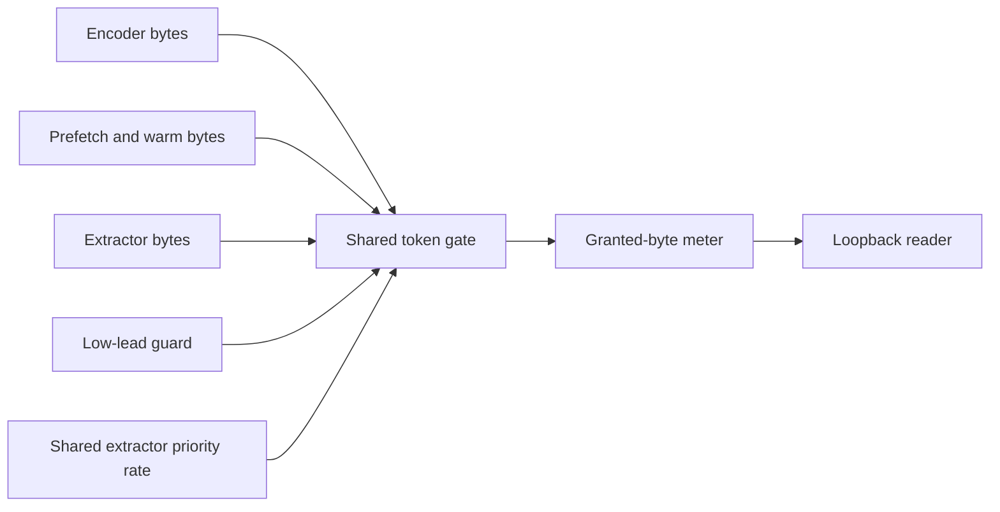

# Network controls

Active contributors: VeroxAUS

Network controls bound remote media reads and advertise useful LAN addresses. `DownloadGate` in `apps/server/src/network/downloadGate.ts` schedules aggregate bytes; `ReadAheadWindow` in `apps/server/src/network/readAhead.ts` controls time hysteresis; `getLanAddresses` in `apps/server/src/net.ts` supplies server-info and discovery addresses.

## Purpose

Keep competing playback/subtitle/prefetch work within the configured household budget without treating intentional waiting as a fault. LAN-address selection is a reachability heuristic, not authentication or a firewall. See [source proxy](source-proxy.md) and [security](../security.md).

## Download defaults and scope

| Setting               | Default and validation                                |
| --------------------- | ----------------------------------------------------- |
| MAX_DOWNLOAD_MBPS     | **150 decimal Mbps**, accepted minimum 5              |
| READ_AHEAD_SEC        | **180 seconds**, positive                             |
| READ_AHEAD_RESUME_SEC | **120 seconds**, positive and below configured window |

`resolveDownloadLimits` in `apps/server/src/network/limits.ts` warns/falls back rather than refusing startup. Invalid window/resume settings reset that pair together. Zero does not disable limits. One Mbps means 1,000,000 bits/second.

The [proxy](source-proxy.md) creates one shared gate for head/tail warming and remote demand reads. It does not cap TMDB/gateway metadata, outbound HLS, all machine traffic or TorBox's remote caching. Cached/local-file reads spend no remote-byte tokens.

## Scheduling and extractor share

`TokenBucket` in `apps/server/src/network/tokenBucket.ts` uses a **0.2-second bucket depth**. Whole chunks may overdraw tokens; the next grant waits for repayment. Readers ask after receiving a chunk and before passing it onward, so these are application-read limits, not control over every byte already in kernel/socket buffers.

Ordinary priority is encoder, prefetch, extractor, then lower lead and arrival order. Waiting requests age after **1500 ms**, but aging never overrides an at-risk encoder below **15 seconds** lead. The guard remembers risk for **200 ms**. While it applies, encoders above 60 seconds wait; intermediate-lead encoders need surplus beyond a 0.05-second reserve.

Extractors share a **20% priority rate** while no encoder is at risk. This is shared among extractor readers, not granted per worker, and is not a reserved slice: unused tokens go elsewhere. The main bucket always governs total grants.

`atLeastExtractorShare` in `apps/server/src/network/downloadGate.ts` raises finite local extractor pacing to that share; null remains unlimited. At 150 Mbps this floor is **3,750,000 bytes/s**, above a proposed 2 MiB/s throttle. Local pacing never bypasses the aggregate gate.

## Read-ahead and feedback

`leadSeconds` in `apps/server/src/network/readAhead.ts` uses the end of the head segment minus playhead. A window holds at its threshold and resumes **strictly below** the resume point. Start/seek/restart resets filling.

`encoderWindowSec` in `apps/server/src/network/readAhead.ts` subtracts a **four-second pipeline allowance**. Defaults therefore hold owned readers at **176 seconds**, then resume below 120. This is intentional headroom, not a configuration mismatch.

`ReadAheadPacing` in `apps/server/src/playback/readAheadPacing.ts` feeds progress, requested/reported position and recent speed to the source handle. Subtitle reach includes the latest video segment request. `ReaderHolds` in `apps/server/src/sourceproxy/readerHolds.ts` keeps viewers independent even when their bytes are shared.

A separate cache-sized byte-gap bound keeps extractor data from evicting what its encoder still needs. Held remote stretches end at block boundaries and stop remote reads; cached bytes also obey holds. These controls differ from [disk parking](playback/lifecycle.md).

## LAN addresses and mDNS

`getLanAddresses` in `apps/server/src/net.ts` collects non-internal IPv4 addresses, excluding `127.*` even if an adapter marks it non-internal. It then prefers candidates that are neither `169.254.*` nor on names matching **vEthernet, WSL, Hyper-V, Docker, VirtualBox or VMware**, case-insensitively.

**Filtering applies only when at least one such physical candidate remains.** Otherwise every non-internal/non-loopback IPv4 candidate is returned, including virtual/link-local addresses. IPv6 is never included; an offline/loopback-only machine yields an empty list.

Addresses are deduplicated and ranked: `192.168.*`, `10.*`, `172.16/12`, other IPv4, link-local last. “Physical” is an adapter-name heuristic, not a verified network route.

`registerInfoRoutes` in `apps/server/src/routes/info.ts` reports this list in `/api/info` and the actual listening port when available. `startDiscovery` and `withAddresses` in `apps/server/src/discovery.ts` use the same list for `_homestream._tcp`: replace all library-generated A/AAAA records with exactly these IPv4 A records while retaining service records. This prevents WSL/Hyper-V addresses from being advertised alongside usable LAN candidates. Goodbye packets use the same record override.

Discovery is best effort, can be disabled with `HOMESTREAM_MDNS=off`, and does not change listener binding. `stripIpv6Prefix` in `apps/server/src/net.ts` separately unwraps IPv4-mapped request addresses; it is not the adapter filter.

## Measurements and modification

`RateMeter` in `apps/server/src/network/rateMeter.ts` uses 250 ms slots; `networkSnapshot` in `apps/server/src/network/snapshot.ts` joins proxy aggregate and session readings. The default reporting window is five seconds. Per-session rates may refer to the same shared source, so do not sum them as separate downloads.

`buildNetworkCheck` in `apps/server/src/network/check.ts` warns after the cap has continuously bound for more than **30 seconds**; it does not turn normal limiting into an error. [Health](health.md) separately interprets falling-behind encoding.

Change fairness in `apps/server/src/network/downloadGate.ts`, window rules in `apps/server/src/network/readAhead.ts`, settings in `apps/server/src/network/limits.ts`, and address heuristics in `apps/server/src/net.ts` plus discovery regression tests. See [playback](playback/index.md) and [configuration](../reference/configuration.md).

## Key source files

| File                                                 | Purpose                                             |
| ---------------------------------------------------- | --------------------------------------------------- |
| `apps/server/src/network/downloadGate.ts`            | Cap, risk guard and shared extractor rate           |
| `apps/server/src/network/tokenBucket.ts`             | Whole-chunk token accounting                        |
| `apps/server/src/network/limits.ts`                  | Validation and unit conversion                      |
| `apps/server/src/network/readAhead.ts`               | Hysteresis/pipeline allowance                       |
| `apps/server/src/net.ts`                             | Filter/rank addresses and normalize request IP      |
| `apps/server/src/discovery.ts`                       | Filtered mDNS record publication                    |
| `apps/server/test/network/bandwidthPriority.test.ts` | Low-lead protection with fake clocks                |
| `apps/server/test/network/extractorShare.test.ts`    | Aggregate share, risk suspension and no reservation |
| `apps/server/test/net.test.ts`                       | Virtual/link-local fallback and ranking             |
| `apps/server/test/discovery.test.ts`                 | A/AAAA replacement and advertised records           |

## Measured scope

At **`0a8f04f`**, scoped `git ls-tree` counts **7 network `.ts` source / 8 matching `*.test.ts` files**, ratio **1.14**. Adjacent LAN discovery scope is **2 source / 2 test files** (`apps/server/src/net.ts`, `apps/server/src/discovery.ts` and their root tests). Proxy/playback, helpers and integration elsewhere are excluded. CODEOWNERS and supplied default-branch history identify **1 unique human**, excluding bots, not an ownership guarantee. No tests, mDNS publication or bandwidth measurements were run.
