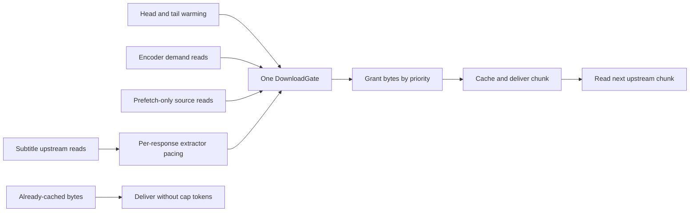

# Network controls

Active contributors: VeroxAUS

Network controls cap aggregate upstream media downloads and stop reading when enough media is buffered. When bandwidth is scarce, lower-lead encoders get priority over already-buffered playback, speculative warming and subtitles (`apps/server/src/network/downloadGate.ts`, `apps/server/src/network/readAhead.ts`).

## Layout and key abstractions

| Module                                    | Responsibility                                          |
| ----------------------------------------- | ------------------------------------------------------- |
| `apps/server/src/network/limits.ts`       | Defaults, validation and decimal-Mbps conversion        |
| `apps/server/src/network/tokenBucket.ts`  | Byte-token accounting on an explicit clock              |
| `apps/server/src/network/downloadGate.ts` | One cap, waiter priority, aging and low-lead protection |
| `apps/server/src/network/readAhead.ts`    | Filling/waiting hysteresis and lead formula             |
| `apps/server/src/network/rateMeter.ts`    | Bounded sliding-window byte meter                       |
| `apps/server/src/network/snapshot.ts`     | Proxy totals joined with playback session readings      |
| `apps/server/src/network/check.ts`        | Live network health status                              |

`SourceProxy` in `apps/server/src/sourceproxy/proxy.ts` creates one `DownloadGate` from `apps/server/src/network/downloadGate.ts`; every remote source entry uses it for head/tail warming and demand reads. This does not cap TMDB/gateway metadata, all server networking, client HLS downloads or TorBox's own remote caching job. The one-byte redirect resolver is outside the media-body gate (`apps/server/src/sourceproxy/sourceEntry.ts`, `apps/server/src/playback/resolveUrl.ts`). Cache regions, opaque source ownership and HTTP recovery belong to the [source proxy](source-proxy.md).

## Aggregate download cap

`MAX_DOWNLOAD_MBPS` defaults to **150 Mbps**, using **1 Mbps = 1,000,000 bit/s**, not MiB/s. Minimum accepted value is **5**; invalid/nonfinite values warn and use the default. Zero is not an unlimited switch (`apps/server/src/network/limits.ts`).

Readers receive a chunk from the socket, ask the gate to account for it, then retain/deliver it before pulling more. The bucket starts with **0.2 seconds** of cap credit; whole chunks can overdraw it and subsequent grants wait for repayment. Long-run accounting is bounded, but initial credit, chunk size and OS/socket buffers mean this is **not an exact packet-level instantaneous bandwidth ceiling** (`apps/server/src/network/tokenBucket.ts`, `apps/server/src/network/downloadGate.ts`, `apps/server/src/sourceproxy/upstream.ts`).

Cached/local-file reads do not spend tokens. Demand read disconnects abort their wait/upstream response. Closing the gate releases waiters and clears its timer; shutdown then closes sources/transport (`apps/server/src/sourceproxy/serve.ts`, `apps/server/src/sourceproxy/proxy.ts`).

## Lead-aware scheduling

Ordinary waiter ordering is:

1. **Encoder/main reads**, rank 0.
2. **Prefetch-only source reads**, rank 1.
3. **Extractor reads**, rank 2.

Within a rank, smaller current lead goes first, then arrival sequence. Priority callbacks are reevaluated at each pick: an entry warmed for prefetch can become a playback-priority entry when a session acquires it. Waiters aged **≥1.5 seconds** advance ahead of unaged requests, preventing low-priority readers from being permanently starved under normal scheduling (`apps/server/src/network/downloadGate.ts`, `apps/server/src/sourceproxy/sourceEntry.ts`).

### Protect a player close to stalling

A held encoder request with **lead <15 seconds** activates the low-lead guard. The condition persists for **200 ms** between requests so a greedy buffered reader cannot take all tokens during the endangered reader's short request gap (`apps/server/src/network/downloadGate.ts`).

While guarded:

| Other encoder lead | Eligibility                                                     |
| ------------------ | --------------------------------------------------------------- |
| <15 seconds        | Still eligible                                                  |
| 15–60 seconds      | Eligible only with surplus above **0.05 seconds** of cap tokens |
| >60 seconds        | Held back, even if aged                                         |

The guard does not reclassify prefetch/extractor ranks; their aging still applies. Without a recently waiting at-risk encoder, buffered sessions can use spare bandwidth normally. This is scheduling policy, not guaranteed stall-free service when aggregate source demand exceeds capacity (`apps/server/src/network/downloadGate.ts`).

The global cap and [subtitle response pacing](playback/subtitles.md#heavy-source-warm-up-and-the-burst-clock) are independent. A locally “unlimited” extractor remains rank 2 under the global gate. Heavy-source warm-up and the delayed fresh-burst clock are playback policy; neither modifies token replenishment, waiter aging or aggregate cap settings (`apps/server/src/playback/extractorSchedule.ts`).

## Read-ahead holds

`ReadAheadWindow` in `apps/server/src/network/readAhead.ts` starts **filling**, changes to **waiting** at the hold threshold, and returns to filling only below the resume threshold or on reset. This hysteresis prevents every advancing segment from toggling the download.

Configured defaults are **180 seconds hold / 120 seconds resume**. Both settings must be positive finite numbers; resume must be strictly below hold. An inconsistent pair resets both to defaults with a warning (`apps/server/src/network/limits.ts`, `apps/server/src/network/readAhead.ts`).

For video, manager lead is `(headSegment+1) × 4 − max(playerPosition, runStart × 4)`. A seek/start/retry opens a fresh window at that run. The source entry closes its main window **4 seconds early**, at `max(1, READ_AHEAD_SEC−4)` (normally **176 seconds**), to allow for FFmpeg's pipeline. Resume requires lead **strictly below 120**, not equal to it (`apps/server/src/playback/manager.ts`, `apps/server/src/sourceproxy/sourceEntry.ts`).

At a hold, the loopback connection stays open but receives no further bytes, including memory hits. The current upstream response is destroyed if unfinished; releasing the hold resumes from the pump's next byte with a ranged request. Local files bypass these remote-pump holds (`apps/server/src/sourceproxy/serve.ts`).

Progress pings and requested video segments synchronize the window. A paused player can therefore reach the ceiling and stop consuming upstream bandwidth while remaining alive through pings. Merely polling session metadata does not advance the playhead or keep the session active (`apps/server/src/playback/manager.ts`).

### Shared sources and subtitles

For multiple session owners of one exact raw URL, the source entry uses the **minimum registered owner lead**. Reading holds only when all reporting owners are sufficiently ahead; each handle still reports its own lead. The entry's byte-rate meter is shared, so two sessions on the same source can expose the same rate (`apps/server/src/sourceproxy/sourceEntry.ts`, `apps/server/src/sourceproxy/proxy.ts`).

Subtitle workers have their own `ReadAheadWindow` per run. Their head is measured against `max(playerReach, runStart)`; holding one run does not hold video or another run. Requests outside the player's configured subtitle reach do not launch far-ahead extraction. See [subtitles](playback/subtitles.md) for progressive coverage and demand-driven earlier gaps (`apps/server/src/playback/subtitleExtractor.ts`, `apps/server/src/playback/manager.ts`).

These holds differ from [disk parking](playback/lifecycle.md), which actually stops the video process. No SIGSTOP/SIGCONT mechanism is used for network backpressure.

## Operational readings

`RateMeter` in `apps/server/src/network/rateMeter.ts` uses **250 ms slots**, retaining 80 slots; proxy and handle callers request a five-second reading. Global numbers come from grants, including warmed head/tail bodies; source numbers come from entry downloads. They measure proxy byte consumption, not packets on a physical NIC (`apps/server/src/network/downloadGate.ts`, `apps/server/src/sourceproxy/sourceEntry.ts`).

The network snapshot includes aggregate rate/cap, configured hold/resume, binding duration and each live session's source rate, lead and filling/waiting state. Binding duration continues across short gaps but resets after **more than 3 seconds** without a limited request. The health check warns only after **more than 30 seconds** binding; otherwise reports OK. It makes no external request (`apps/server/src/network/snapshot.ts`, `apps/server/src/network/check.ts`). See [health](health.md) and [monitoring](../how-to-monitor/index.md).

A separate falling-behind watch reports sessions with positive recent speed **<1× for more than 30 seconds** while filling. Waiting at the configured window, completed/parked/not-running encoders, or unknown zero speed break the streak. This diagnoses slow encoding; it does not stop or rerank the session by itself (`apps/server/src/playback/fallingBehind.ts`, `apps/server/src/playback/manager.ts`).

## Modification and test pointers

Keep token arithmetic pure/clock-driven, reevaluate live priority, preserve guard/aging interaction and abort cleanup. Change limit parsing independently of gate scheduling. Wiring lives in `apps/server/src/app.ts`; defaults and restart requirements are documented in [configuration](../reference/configuration.md).

Measured at `7eb94ba`: **7 source `.ts` / 7 `*.test.ts` / 1 non-test TypeScript helper file** under `apps/server/src/network` and `apps/server/test/network`, test/code file ratio **7/7 = 1.00**. Scoped default-branch history has **1 unique human committer, VeroxAUS**, excluding bots. Proxy transport tests are separate from this count; the ratio is not line or branch coverage.

Fake-clock tests check rate windows, overload/underload priority, guard expiry, aging and aborts. Proxy tests exercise actual loopback sharing/holds. The independent stub-CDN **five-second cap-window measurement is Windows-only** because Linux loopback buffers distort sender-side early windows; deterministic gate tests still cover cap math on all platforms (`apps/server/test/sourceproxy/bandwidthCap.test.ts`, `apps/server/test/network/bandwidthPriority.test.ts`). Tests were inspected, not executed for this documentation.

## Key source files

| Repository-root path                                   | Role                                                  |
| ------------------------------------------------------ | ----------------------------------------------------- |
| `apps/server/src/network/downloadGate.ts`              | Aggregate cap, priority and low-lead guard            |
| `apps/server/src/network/tokenBucket.ts`               | Chunk overdraft and replenishment                     |
| `apps/server/src/network/readAhead.ts`                 | Hold/resume state machine                             |
| `apps/server/src/network/limits.ts`                    | Settings and unit conversion                          |
| `apps/server/src/network/rateMeter.ts`                 | Sliding download measurements                         |
| `apps/server/src/network/check.ts`                     | Network warning threshold                             |
| `apps/server/src/sourceproxy/sourceEntry.ts`           | Shared-owner leads, gate calls and source meter       |
| `apps/server/src/sourceproxy/serve.ts`                 | Pump holds, cancellation and pacing                   |
| `apps/server/src/playback/manager.ts`                  | Position/head feedback and network session projection |
| `apps/server/test/network/downloadGate.test.ts`        | Fake-clock cap/fairness tests                         |
| `apps/server/test/network/bandwidthPriority.test.ts`   | Low-lead overload regressions                         |
| `apps/server/test/sourceproxy/readAheadWindow.test.ts` | Live loopback hold/resume tests                       |
