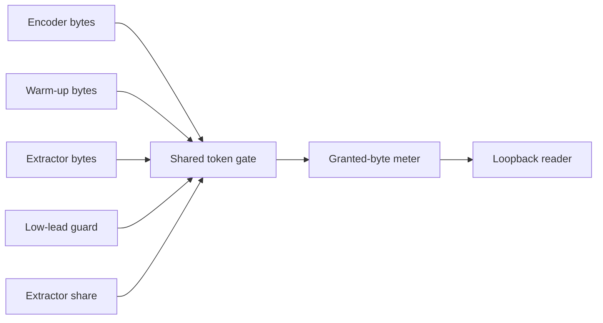

# Network controls

Active contributors: VeroxAUS

## Purpose

Network controls cap remote media bytes and pause readers when sufficient media is buffered. `DownloadGate` in `apps/server/src/network/downloadGate.ts` handles aggregate scheduling; `ReadAheadWindow` in `apps/server/src/network/readAhead.ts` handles time-window hysteresis.

## Layout and defaults

| Setting | Default and validation |
| --- | --- |
| MAX_DOWNLOAD_MBPS | **150 decimal Mbps**, minimum accepted 5 |
| READ_AHEAD_SEC | **180 seconds** |
| READ_AHEAD_RESUME_SEC | **120 seconds**, strictly below read-ahead |

`resolveDownloadLimits` in `apps/server/src/network/limits.ts` warns and falls back on invalid settings; invalid window/resume settings reset the pair together. Zero does not disable limits. One Mbps is 1,000,000 bits/s.

The source proxy creates one gate shared by remote head/tail warming and demand reads (`apps/server/src/sourceproxy/proxy.ts`). This is not a limit on TMDB/gateway metadata, outbound HLS, all machine traffic or TorBox's remote caching job. Cached/local-file reads do not spend remote-byte tokens.

## Scheduling and extractor share

`TokenBucket` in `apps/server/src/network/tokenBucket.ts` backs the gate with a **0.2-second** bucket depth. Readers request grants before passing downloaded chunks onward; scheduling controls application reads, not every byte already buffered by the OS.

Ordinary priority is encoder, prefetch, extractor, with lower encoder lead first. Requests age after **1500 ms**, but aging does not override protection of an encoder at risk below **15 seconds** lead. The low-lead guard remembers contention for **200 ms**; other encoders with high lead or no surplus wait.

Extractors have a **20% priority share** of the cap while no encoder is at risk. It is not a reserved slice: unused tokens go to other readers, and the main bucket still caps total grants. Even aged extractors yield to at-risk video (`apps/server/src/network/downloadGate.ts`).

`atLeastExtractorShare` in `apps/server/src/network/downloadGate.ts` raises finite extractor pacing to this share, while null remains unlimited. At the default 150 Mbps cap the floor is **3,750,000 bytes/s**, so a proposed 2 MiB/s local throttle is raised. Local pacing never bypasses the aggregate gate.

## Read-ahead and source ownership

`leadSeconds` in `apps/server/src/network/readAhead.ts` measures the end of the current head segment minus player position. Hysteresis holds at the threshold and resumes strictly below the resume point. Starts/seeks/restarts reset filling.

`encoderWindowSec` in `apps/server/src/network/readAhead.ts` subtracts a **four-second pipeline allowance**, so default owned readers hold at **176 seconds**, then resume below 120. This distinction matters when comparing configuration to observed finished-segment lead.

`ReadAheadPacing` in `apps/server/src/playback/readAheadPacing.ts` feeds encoder progress, reported/requested playhead and recent speed into the source handle. Subtitle reach includes the latest requested video segment. Each session gets its own main/run windows through `apps/server/src/sourceproxy/readerHolds.ts`; a shared byte cache does not imply one viewer's window holds another viewer.

The proxy also has an independent cache-sized extractor byte-gap hold. Held remote readers stop upstream stretches on block boundaries and remain connected; cached bytes obey holds too (`apps/server/src/sourceproxy/serve.ts`). See [source proxy](source-proxy.md).

## Measurements and modification

`RateMeter` in `apps/server/src/network/rateMeter.ts` tracks byte windows; `apps/server/src/network/snapshot.ts` joins aggregate and per-session data; `apps/server/src/network/check.ts` interprets health. Per-session rates can describe the same shared source, so do not sum them as independent downloads.

Change fairness in `apps/server/src/network/downloadGate.ts`, settings in `apps/server/src/network/limits.ts`, and time holds in `apps/server/src/network/readAhead.ts`. Preserve deterministic fake-clock tests and distinguish intentional holds from slow encoding. See [playback](playback/index.md) and [configuration](../reference/configuration.md).

## Key source files

| File | Purpose |
| --- | --- |
| `apps/server/src/network/downloadGate.ts` | Cap, risk guard and share |
| `apps/server/src/network/tokenBucket.ts` | Token accounting |
| `apps/server/src/network/limits.ts` | Settings |
| `apps/server/src/network/readAhead.ts` | Hysteresis/pipeline allowance |
| `apps/server/src/network/rateMeter.ts` | Window rates |
| `apps/server/src/playback/readAheadPacing.ts` | Playback feedback |

## Measured scope

At `5eefa37`, `git ls-files` counts **7 network `.ts` source / 8 matching `*.test.ts` files**, ratio **1.14**. Helpers/proxy/integration files are excluded. Default-branch history/CODEOWNERS identify **1 unique human author**, excluding bots. No bandwidth measurement or live tests were run for this page.
