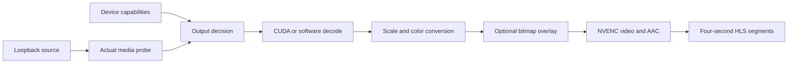

# Encoding

Active contributors: VeroxAUS

HomeStream always re-encodes video with NVENC. `decide` in `apps/server/src/playback/decision.ts` chooses compatible output; `buildFfmpegArgs` in `apps/server/src/playback/ffmpegArgs.ts` implements decode, filters, audio and HLS muxing.

## Purpose

Convert an actual probed source into one device-compatible HLS variant without exposing its upstream URL. Software decoding or color conversion is supported; there is no software video-encoder fallback. Return to [playback](index.md) for session startup.

## Probe and output policy

`ProbeResult` in `apps/server/src/playback/probe.ts` supplies duration, real video, audio and supported subtitle metadata. Attached pictures/image codecs are skipped. Analysis uses `-probesize 8M -analyzeduration 3M`; the default ffprobe timeout is 60 seconds.

| Concern             | Policy                                                                                              |
| ------------------- | --------------------------------------------------------------------------------------------------- |
| Video codec         | HEVC when the device advertises it; otherwise H.264                                                 |
| Dimensions          | Preserve aspect ratio, round to even sizes, fit device limits, never upscale                        |
| HDR output          | HDR10/HLG or non-profile-5 Dolby Vision can become HDR10 only with device HEVC/Main10/HDR10 support |
| Other non-SDR input | Tone-map to SDR                                                                                     |
| Audio               | AAC; TV capped by source/device and six channels, other clients at most stereo                      |
| Default audio       | Requested valid track, otherwise default English, English, default, first                           |
| No source audio     | Disable output audio                                                                                |

Dolby Vision retention means HDR10 output, not Dolby Vision passthrough. Subtitle choice is separate [policy](subtitles.md).

## Color conversion and decode paths

`canHwDecode` in `apps/server/src/playback/ffmpegArgs.ts` allowlists codecs/pixel formats and excludes unsupported high-bit-depth H.264. Normal supported jobs use CUDA decode/scale. Bitmap burn-in generally uses software decode; the special retained-HDR high-resolution path uses NVDEC, and excludes HLG-to-PQ.

`needsHlgToPq` in `apps/server/src/playback/decision.ts` identifies HLG retained as HDR10. The primary Vulkan/libplacebo path converts pixels to PQ/BT.2020 before tagging them; it does not just relabel HLG.

If this filter path fails before its first segment, `Recovery` in `apps/server/src/playback/recovery.ts` selects the alternate path and `PlaybackContext` in `apps/server/src/playback/context.ts` remembers that choice for later sessions. Alternate retained-HLG conversion uses software-decoded **zscale**, HLG to SMPTE 2084, nominal peak **1000 nits**, p010 output. Alternate HDR-to-SDR uses **OpenCL/Hable**. Both still feed NVENC.

Bitmap canvases are frame-rate-limited before scaling, then overlaid after video conversion. Retained HDR overlay stays 10-bit and scales subtitle white to the configured PQ reference white. See [subtitles](subtitles.md) for why this avoids packet-driven duplicate canvases.

## HLS and rate control

`videoBitrate` in `apps/server/src/playback/decision.ts` contains output policy, not measured throughput:

| Output height | HEVC target/max kbps | H.264 target/max kbps |
| ------------- | -------------------: | --------------------: |
| ≥1800         |          20000/30000 |           28000/40000 |
| ≥900          |           8000/12000 |           10000/15000 |
| ≥600          |            5000/8000 |             5000/8000 |
| Lower         |            2500/4000 |             2500/4000 |

Video uses preset p4, HQ tuning, VBR, no B-frames and a buffer twice maximum bitrate. AAC uses 48 kHz, 192 kbps through stereo or 64 kbps/channel above stereo. Thread settings choose GPU-oriented or CPU-filter/decode caps; they are hints, not CPU quotas.

`SEGMENT_SECONDS` in `apps/server/src/playback/playlist.ts` fixes the **four-second grid**. FFmpeg forces aligned keyframes and publishes finished files via temporary names. HEVC uses fMP4; H.264 uses MPEG-TS with zero mux delay/preload. Source metadata/chapters and unselected subtitles/data are not copied into output.

Restarts at segment N seek to N×4 seconds and use absolute output offsets. fMP4 fragment discontinuity flags keep segments from different runs compatible with one init; the server publishes a completed init copy, not the encoder's in-progress file. Bitmap burn-in seeks up to ten seconds earlier and trims the lead-in so already-active cues can survive. See [lifecycle](lifecycle.md).

`ProgressParser` in `apps/server/src/playback/progress.ts` parses completed key/value blocks; the HLS bitrate display is derived from finished segment sizes by `bitrateKbpsFromSegments` in `apps/server/src/playback/stats.ts`.

## Modification entry points

Change compatibility/bitrates in `apps/server/src/playback/decision.ts`, probe interpretation in `apps/server/src/playback/probe.ts`, and actual graphs/timestamps in `apps/server/src/playback/ffmpegArgs.ts`. Preserve loopback inputs, the shared segment grid and completed-init publication. RSS protection and priority lowering belong to [lifecycle](lifecycle.md), not codec selection.

## Key source files

| File                                                             | Purpose                                            |
| ---------------------------------------------------------------- | -------------------------------------------------- |
| `apps/server/src/playback/decision.ts`                           | Compatibility, channels, bitrate and HLG detection |
| `apps/server/src/playback/probe.ts`                              | Bounded media analysis                             |
| `apps/server/src/playback/ffmpegArgs.ts`                         | Decode/filter/NVENC/mux arguments                  |
| `apps/server/src/playback/playlist.ts`                           | Container/grid and manifest rules                  |
| `apps/server/test/playback/decision.test.ts`                     | Device/output policy                               |
| `apps/server/test/playback/ffmpegArgs.test.ts`                   | Offline argument/filter/timestamp regressions      |
| `apps/server/test/playback/ffmpegArgsHlg.test.ts`                | Real HLG-to-PQ argument paths                      |
| `apps/server/test/integration/playback-manager-recovery.test.ts` | Remembered filter fallback                         |

## Measured scope

At **`0a8f04f`**, `git ls-tree` counts **42 `.ts` playback source / 35 `*.test.ts` playback-plus-encode files**, ratio **0.83**. This is playback-wide, not encoding-only; helpers and integration elsewhere are excluded, and scope overlaps the other playback pages. CODEOWNERS and supplied default-branch history identify **1 unique human**, excluding bots, not an ownership guarantee. Tests were inspected; no encodes or tests were run.
