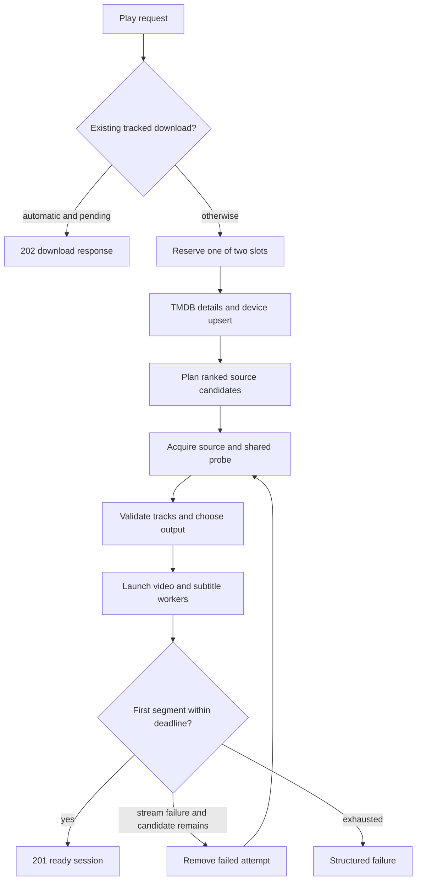

# Playback

Active contributors: VeroxAUS

Playback turns a title request and device capabilities into seekable, server-encoded HLS. The manager waits for usable video before returning success and can try another ranked source when an automatic start fails (`apps/server/src/playback/manager.ts`).

## Layout and key abstractions

| Area                  | Implementation                                                                                 | Detail                                                     |
| --------------------- | ---------------------------------------------------------------------------------------------- | ---------------------------------------------------------- |
| Orchestration         | `apps/server/src/playback/manager.ts`                                                          | Session reservation, startup, serving, changes and cleanup |
| Session state         | `apps/server/src/playback/session.ts`                                                          | `SessionRecord` and client/activity projections            |
| Output policy         | `apps/server/src/playback/decision.ts`, `apps/server/src/playback/ffmpegArgs.ts`               | [Encoding](encoding.md)                                    |
| Tracks and extraction | `apps/server/src/playback/defaultSubtitle.ts`, `apps/server/src/playback/subtitleExtractor.ts` | [Subtitles](subtitles.md)                                  |
| Resource controls     | `apps/server/src/playback/monitor.ts`, `apps/server/src/playback/memoryWatchdog.ts`            | [Lifecycle](lifecycle.md)                                  |
| HLS timeline          | `apps/server/src/playback/playlist.ts`                                                         | One variant and duration-derived manifests                 |

A record owns a `SourceHandle`, probe, device/output decision, segment store, video process, progressive subtitle controller, generation token and player state. It is not a direct-play/remux decision or an adaptive-bitrate ladder.

## Start-to-first-segment flow

The thin POST handler validates the shared schema and returns **201** for a session or **202** for a tracked download (`apps/server/src/routes/sessions.ts`). Clients use `streamId: "auto"`; explicit IDs are still supported by the server contract.

1. **Reserve before asynchronous work.** `liveRecords().length + starting` must remain below **2**. Opening records are counted only by `starting`, avoiding double counting. A third start gets 429 `too_many_sessions` before resolution, probing or encoder creation. The reservation is released in `finally`; failed sessions do not occupy live slots (`apps/server/src/playback/manager.ts`, `apps/server/test/integration/session-limit.test.ts`).
2. Fetch movie/show details, register/update the device and ask stream selection for at most **3** automatic candidates. The ranking/device ceiling is documented in [stream selection](../../features/stream-selection.md). Auto discovery needs an IMDb ID. An explicit ID gets one candidate and no cross-source fallback.
3. If no cached source exists and downloads are configured, begin [TorBox tracking](../../features/downloads.md). A tracked job returns 202, not an active encoder. A link found already playable falls through to normal startup. An already-pending automatic download bypasses the slot and metadata work altogether.
4. Acquire the candidate through the [source proxy](../source-proxy.md). A [prefetch](../../features/prefetch.md) can supply a shared successful probe and already-warmed bytes. Validate audio/subtitles, apply automatic subtitle defaults only when the request omitted the subtitle field, and derive the encode decision.
5. Create a UUID output directory and provisional play row. Register the opening record, start video and text extraction together, then wait up to **30 seconds**, polling every **25 ms**, for the run's first finished segment.
6. Once the file exists, mark ready, make the record visible in session listing/activity, emit `session.start` and return the response. A first-segment wait is separate from source-resolution/probe time, so 30 seconds is **not** an end-to-end request limit (`apps/server/src/playback/manager.ts`).

The response preserves the requested start position, but encoding starts at `min(lastSegment, floor(startPositionSec / 4))`. It includes the successful `streamId` and earlier failed `{streamId, code}` attempts, never raw upstream links (`apps/server/src/playback/session.ts`).

## Fallback and failure boundaries

Automatic cached starts try candidates sequentially. Resolution placeholders, probe failures, encoder failure after its internal retry, and first-segment timeout can all advance to the next candidate. Bad audio/subtitle selections and shutdown abort without fallback. An uncached single-candidate plan returns its specific error instead of wrapping it (`apps/server/src/playback/manager.ts`).

An unsuccessful opening attempt is abandoned: generation is invalidated, video/subtitles stop, the source lease is released, its directory is removed and its provisional play row is deleted. No successful-start event is emitted. Exhausting cached candidates returns 502 `all_streams_failed` with the attempt list; explicit IDs retain their own error (`apps/server/test/integration/playback-fallback.test.ts`, `apps/server/src/errors.ts`).

Once a session has started, the manager retries a failed encoder on the **same source** once; it does not switch to another candidate mid-play. Recovery, memory-limit behavior and residual failed records are covered in [lifecycle](lifecycle.md).

## HLS serving and client state

The master has one video variant, with optional WebVTT renditions. HEVC uses fMP4 (`seg-N.m4s`, `init.mp4`); H.264 uses MPEG-TS (`seg-N.ts`). Video/subtitle playlists list the full duration from sequence zero and end with `EXT-X-ENDLIST`; they promise positions, not already-existing files (`apps/server/src/playback/playlist.ts`).

A present video segment is served directly. A missing one waits for a nearby encoder or causes a serialized seek restart. FFmpeg's internal `enc.m3u8` is not the client playlist. HTTP responses are no-cache; segment/init byte counts feed viewing statistics (`apps/server/src/playback/manager.ts`, `apps/server/src/routes/sessions.ts`).

Progress pings update position and `playing`, `paused` or `buffering` state; ordinary metadata polling does not keep a session alive. Pings and requested video segments feed the [network read-ahead window](../network.md). Persistence/resume semantics belong to [viewing progress](../../features/viewing-progress.md).

## Modification and test pointers

Change orchestration in `apps/server/src/playback/manager.ts`, policy in pure decision/track modules, and contract fields in [shared schemas](../../packages/shared.md). Keep handlers thin. Preserve reservation accounting, failed-attempt cleanup, first-segment success and generation checks when changing startup.

Measured playback scope: **27 source `.ts` files**, **24 `*.test.ts` files** (15 playback + 9 encode), **4 helper files**, test/code ratio **0.89**, and **1 unique human author** in scoped `origin/main` history. [Systems](../index.md) defines the counting scope; additional integration tests are excluded from these totals.

Offline fallback, reservation and default-subtitle integration tests use fake encoders. Real-media seek/output/extraction tests live under `apps/server/test/encode` and require the GPU tier. Tests were read, not run.

## Key source files

| Repository-root path                                     | Role                                          |
| -------------------------------------------------------- | --------------------------------------------- |
| `apps/server/src/playback/manager.ts`                    | Startup/fallback coordinator                  |
| `apps/server/src/playback/session.ts`                    | State and response fields                     |
| `apps/server/src/playback/startTimeline.ts`              | Per-attempt startup timing trail              |
| `apps/server/src/playback/playlist.ts`                   | HLS names, formats and full timeline          |
| `apps/server/src/routes/sessions.ts`                     | Thin API and HLS handlers                     |
| `apps/server/test/integration/playback-fallback.test.ts` | Source fallback and absence of residue        |
| `apps/server/test/integration/session-limit.test.ts`     | Two-session limit and concurrent reservations |
| `apps/server/test/encode/hls-encode.test.ts`             | Real encoded output expectations              |
