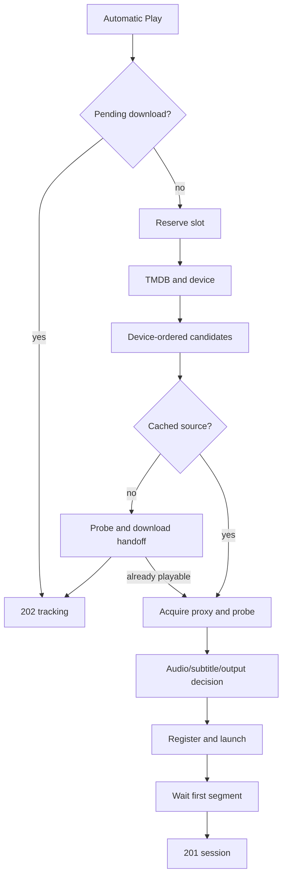

# Playback

Active contributors: VeroxAUS

## Purpose

Playback turns an automatic title request into device-compatible HLS, with a first-segment readiness gate and bounded source fallback. `PlaybackManager` in `apps/server/src/playback/manager.ts` exposes the route-facing facade while focused modules own startup, processes, recovery, serving and subtitles.

## Layout and abstractions

| Module | Responsibility |
| --- | --- |
| `apps/server/src/playback/context.ts` | Shared options, watchdog, registry and slots |
| `apps/server/src/playback/sessionSlots.ts` | Reservations, records, draining and teardown |
| `apps/server/src/playback/sessionStart.ts` | Discovery through first playable segment |
| `apps/server/src/playback/encoderLifecycle.ts` | Launch/progress/park/resume |
| `apps/server/src/playback/recovery.ts` | Failure retry, seeks and track reconfiguration |
| `apps/server/src/playback/hlsServing.ts` | Manifests, safe init publication and segment waits |
| `apps/server/src/playback/subtitleHandoff.ts` | Progressive subtitle HTTP readiness |
| `apps/server/src/playback/readAheadPacing.ts` | Playhead feedback and extractor scheduling |

`SessionRecord` in `apps/server/src/playback/session.ts` distinguishes public state from internal opening, generation, restart and parked state. Source handles belong to the [proxy](../source-proxy.md), not the encoder child.

## Start control flow

`SessionStarter` in `apps/server/src/playback/sessionStart.ts` reuses existing automatic download tracking before reserving a slot or fetching metadata. Otherwise it reserves against the default **two video-session places**, upserts device capabilities, resolves metadata and plans candidates.

Automatic starts try at most **three cached candidates** using `apps/server/src/streams/rank.ts`. Known fitting tiers come first, above-device tiers ascend next, unknown resolution last. Uncached titles use one recommendation and can return 202 tracking without a session/playlist. Invalid user track selections and shutdown are not source faults and do not trigger another candidate.

For each attempt, a unique owner acquires the raw stream through the proxy, reusing retained prefetch bytes/probe results. Uncached sources with listed size at least 20 MiB are rejected as downloading clips when actual size is below 10% of the listing (`apps/server/src/playback/placeholder.ts`). Redirect placeholder checks also run before clips are requested.

Actual probe metadata drives audio/subtitle defaults and [encoding](encoding.md). The record/history row is registered, then video and text extraction start together. Startup waits up to **30 seconds by default**, polling every **25 ms**, for the first finished segment. Opening records are not returned by session lists/activity. A failed attempt is abandoned before fallback; a stuck old encoder prevents an overlapping replacement.

## HLS and continuing playback

`apps/server/src/playback/playlist.ts` builds duration-derived manifests on a four-second grid. HEVC uses fragmented MP4; H.264 uses MPEG-TS. Full-title manifests allow seeks to trigger production on demand rather than requiring a fully encoded title.

[Lifecycle](lifecycle.md) explains serialized seek/track restarts, stable master metadata, complete init copies, disk parking, stop escalation and stuck-slot retention. [Subtitles](subtitles.md) explains unread versus silent intervals and bitmap burn-in.

The facade also accepts progress pings and transactionally saves resume/history state; [viewing progress](../../features/viewing-progress.md) distinguishes watched time from position.

## Modification entry points

Change candidate planning/first-segment behavior in `apps/server/src/playback/sessionStart.ts`; process ownership in `apps/server/src/playback/sessionSlots.ts`; recovery ordering in `apps/server/src/playback/recovery.ts`. Keep public schema changes in [shared contracts](../../packages/shared.md). Preserve the no-overlap and failed-start cleanup boundaries.

## Key source files

| File | Purpose |
| --- | --- |
| `apps/server/src/playback/manager.ts` | Facade and progress/track API |
| `apps/server/src/playback/sessionStart.ts` | Startup attempts |
| `apps/server/src/playback/sessionSlots.ts` | Admission and lifetime |
| `apps/server/src/playback/sessionRecord.ts` | Record construction |
| `apps/server/src/playback/placeholder.ts` | Clip classification |
| `apps/server/src/playback/support.ts` | Options and shared helpers |

## Measured scope

At `5eefa37`, scoped `git ls-files` counts **42 `.ts` playback source files** and **35 `*.test.ts` files** in `apps/server/test/playback/` plus `apps/server/test/encode/`: **0.83 tests/source**. Helpers and integration tests elsewhere are excluded. This same overlapping playback scope is used on its subpages. Default-branch history/CODEOWNERS identify **1 unique human author**, excluding bots. No GPU/live tests were run.
