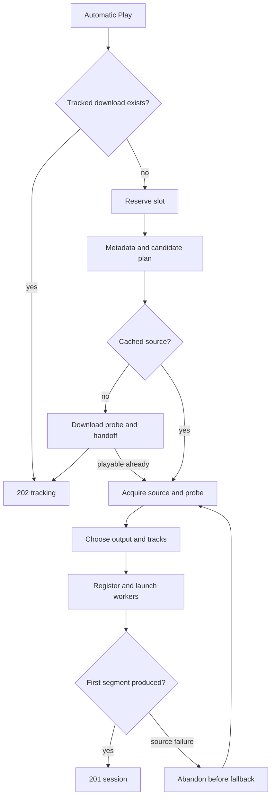

# Playback

Active contributors: VeroxAUS

`PlaybackManager` in `apps/server/src/playback/manager.ts` turns a title request into device-compatible HLS. It is a facade: focused modules handle admission, source attempts, encoding, recovery, serving and subtitles.

## Purpose

Playback owns server-side media work and exposes stable session/HLS URLs. Clients request `streamId: "auto"`; the server always re-encodes video. A start either returns a **201 ready session**, a **202 remote-download tracking result**, or an actionable error. See [web player](../../apps/web/player.md) for client behavior.

## Layout and abstractions

| Module                                         | Responsibility                                                               |
| ---------------------------------------------- | ---------------------------------------------------------------------------- |
| `apps/server/src/playback/context.ts`          | Shared options, slots, PID registry, watchdog and remembered filter fallback |
| `apps/server/src/playback/sessionSlots.ts`     | Reservations, records, draining and teardown                                 |
| `apps/server/src/playback/sessionStart.ts`     | Candidate planning through first finished segment                            |
| `apps/server/src/playback/sessionRecord.ts`    | Initial session/history values                                               |
| `apps/server/src/playback/encoderLifecycle.ts` | Launch, progress, park and resume                                            |
| `apps/server/src/playback/recovery.ts`         | Retry, seek and track replacement ordering                                   |
| `apps/server/src/playback/hlsServing.ts`       | Manifests, safe init publication and segment waits                           |
| `apps/server/src/playback/subtitleHandoff.ts`  | Progressive subtitle readiness                                               |
| `apps/server/src/playback/readAheadPacing.ts`  | Playhead, read-ahead and extractor feedback                                  |

`SessionRecord` in `apps/server/src/playback/session.ts` separates public state from internal opening, generation, restart, stopped-input and parked behavior. A source handle belongs to the [proxy](../source-proxy.md); a worker exit does not alone release the session's source.

## Start flow

`SessionStarter` in `apps/server/src/playback/sessionStart.ts` first reuses automatic download tracking, avoiding a slot, gateway lookup and metadata call. Otherwise it reserves one of the default **two video-session places**, reads title metadata, upserts device capabilities and plans candidates.

Automatic starts try at most **three cached sources**. `startCandidates` in `apps/server/src/streams/rank.ts` orders known fitting resolution tiers first, known above-device tiers ascending next, and unknown resolution last. Actual encoding still fits the device. Uncached titles use one recommendation and may hand off to [downloads](../../features/downloads.md), with no session/playlist. The API still accepts an explicit ID for one attempt; that is not a manual-picker product workflow.

Each candidate gets a unique owner, acquires its source through the proxy and reuses retained [prefetch](../../features/prefetch.md) bytes/probe results. `clipSizeImplausible` in `apps/server/src/playback/placeholder.ts` rejects uncached responses below 10% of a known listing of at least 20 MiB. Redirect placeholder checks reject clips before fetching them.

Actual probe metadata, not release-name hints, drives audio, subtitle and [encoding](encoding.md) decisions. After record/history creation, video and text extraction start together. The default first-segment wait is **30 seconds**, polling every **25 ms**; it includes the encoder's own single retry. Opening records stay out of session lists/activity.

A failed attempt releases source ownership and abandons its temporary record/files/history before another source is tried, subject to late-exit cleanup. Invalid track selections, shutdown and `encoder_not_stopped` are not source faults. A surviving old encoder blocks fallback instead of overlapping it. Exhausted cached attempts return `all_streams_failed` with URL-free attempt codes.

## Continuing playback

`generatePlaylist` in `apps/server/src/playback/playlist.ts` exposes a duration-derived VOD manifest on a **four-second grid**: HEVC/fMP4 or H.264/MPEG-TS. It can name segments not yet produced, allowing distant requests to trigger seek encoding rather than downloading/encoding an entire title first.

[Lifecycle](lifecycle.md) covers serialized replacement, late exits, init readiness, disk/idle cleanup and recovery. [Subtitles](subtitles.md) distinguishes real silence from unread intervals. [Network controls](../network.md) bounds read-ahead and competing media reads.

The facade also accepts progress pings, saving resume and play-history state in a transaction. Watching time excludes paused/buffering intervals; it is not simply the current position. See [viewing progress](../../features/viewing-progress.md). `PlaybackObserver` in `apps/server/src/playback/observer.ts` reports start/end/failure/restart, never each segment; [telemetry](../telemetry.md) stays outside media policy.

## Modification entry points

Change source attempts in `apps/server/src/playback/sessionStart.ts`, admission/lifetime in `apps/server/src/playback/sessionSlots.ts`, and replacement ordering in `apps/server/src/playback/recovery.ts`. `StartTimeline` in `apps/server/src/playback/startTimeline.ts` emits fixed debug milestones across attempts for startup diagnosis. Wire contract changes through [shared](../../packages/shared.md) and the [API](../../api/index.md).

## Key source files

| File                                                           | Purpose                                    |
| -------------------------------------------------------------- | ------------------------------------------ |
| `apps/server/src/playback/manager.ts`                          | Facade, track/progress API                 |
| `apps/server/src/playback/sessionStart.ts`                     | Planning, launch and readiness             |
| `apps/server/src/playback/sessionSlots.ts`                     | Capacity and lifetime                      |
| `apps/server/src/playback/session.ts`                          | Internal/public record mapping             |
| `apps/server/src/playback/startTimeline.ts`                    | Request-relative startup milestones        |
| `apps/server/test/integration/playback-fallback.test.ts`       | Automatic attempts and first-segment gate  |
| `apps/server/test/integration/playback-start-failure.test.ts`  | Failed-start history/event behavior        |
| `apps/server/test/integration/playback-fallback-stuck.test.ts` | Refuse fallback beside a surviving encoder |

## Measured scope

At **`0a8f04f`**, scoped `git ls-tree` counts **42 playback `.ts` source files** and **35 `*.test.ts` files** in `apps/server/test/playback/` plus `apps/server/test/encode/`: **0.83 test files/source file**. Helpers and integration tests elsewhere are excluded; subpages reuse this overlapping playback-wide scope. CODEOWNERS and supplied default-branch history identify **1 unique human**, excluding bots, not an ownership guarantee. Tests were inspected, not run; no GPU/live work was launched.
