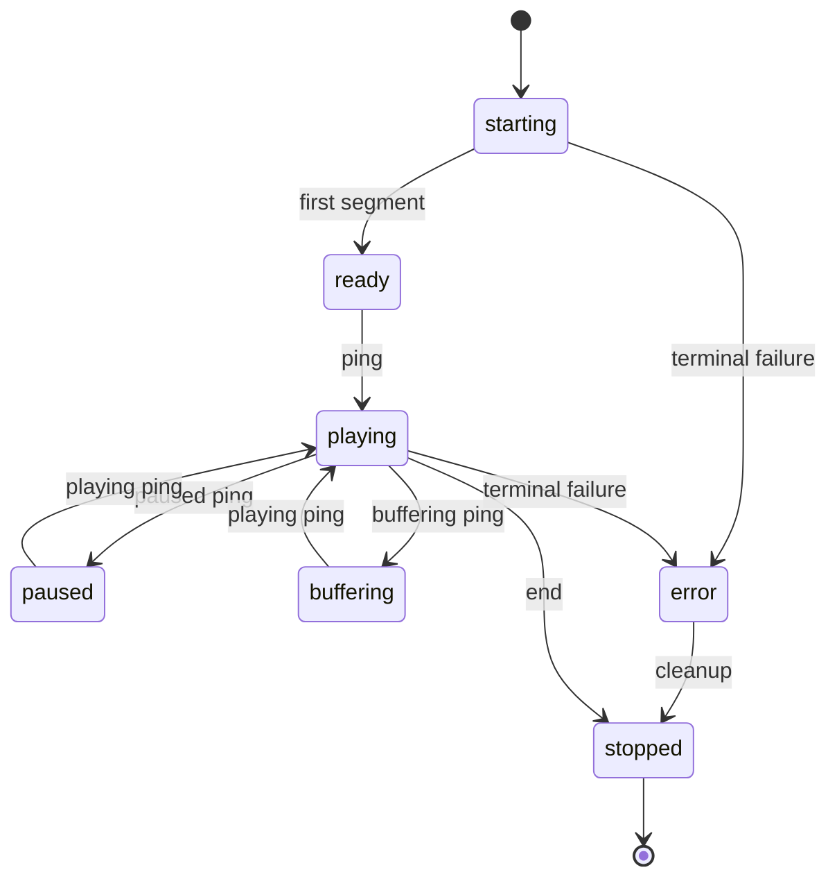

# Playback lifecycle

Active contributors: VeroxAUS

## Purpose

Playback must not start a replacement encoder until the previous one has exited. `SessionSlots` in `apps/server/src/playback/sessionSlots.ts` accounts for opening, live, failed-but-running and draining work; `Recovery` in `apps/server/src/playback/recovery.ts` serializes restart operations.

## State and ownership

`SessionRecord` in `apps/server/src/playback/session.ts` keeps public starting/ready/playing/paused/buffering/error/stopped state separate from generation, opening, parked and restart flags. Failed encodes disappear from active activity while their record can remain available for inspection.

This diagram abbreviates transitions: stop applies to every state, and any nonfailed ready/ping state may adopt the next ping state (`apps/server/src/playback/manager.ts`).

## Admission and stuck encoders

`apps/server/src/playback/sessionSlots.ts` defaults to **two video-session slots**. A reservation counts before metadata/proxy work. Opening records count through reservations rather than double-counting as live.

Ending a session removes its public record, but holds a draining place during stop. If the child survives bounded kill retries, the place stays taken until its actual exit promise resolves. Session directory deletion is deferred to that exit. Failed-but-running records also continue consuming a place. An abandoned opening attempt with a surviving encoder blocks unsafe fallback instead of launching another video process.

`recordStuckStop` in `apps/server/src/playback/stuckStop.ts` records one error per process/reason and a later exit event, without URLs or paths. A bounded stop resolving is not proof the process exited.

## Stop and replacement ordering

`EncoderProcess` in `apps/server/src/playback/encoderProcess.ts` sends q, waits a grace interval, then uses bounded kill retries from `apps/server/src/playback/killUntilExited.ts`. Ordinary end/shutdown grace is **3000 ms**. Discarded-output operations use **1000 ms** and cut the encoder's proxy input before q.

`stopDiscarded` in `apps/server/src/playback/discardStop.ts` checks the child's running flag after stop. A survivor yields **503 `encoder_not_stopped`** and no replacement. `InputCuts` in `apps/server/src/sourceproxy/inputCuts.ts` destroys that owner's main reads and rejects reconnects until the next successful launch reopens input. Other sessions and subtitle readers are not cut.

Seek, retry and track operations share the record's restart promise (`apps/server/src/playback/recovery.ts`). Generation checks ignore stale progress/exit callbacks. Retry includes the link-refresh wait inside that serialized operation, preventing a segment request from launching beside it. Shutdown races refresh waiting against stop notification.

## Segments, seeks and track changes

`HlsServing` in `apps/server/src/playback/hlsServing.ts` serves existing finished files; missing distant/lost segments trigger recovery at the requested index. A running encoder can satisfy indexes from head−1 through head+5, provided they are at/after its start. File waits default to 30 seconds with bounded lost-segment serving attempts.

A backward segment jump more than two segments updates position immediately instead of retaining an old forward ping. Recovery also aligns position at seek and notifies subtitle scheduling.

Audio or bitmap burn-target changes discard incompatible segments and the ready init copy, then restart at reported position. Text-only selection does not restart video. A refused restart restores audio/subtitle/default provenance and stored decision (`apps/server/src/playback/manager.ts`).

The master advertises the maximum device-compatible audio channels across all source tracks through `masterAudioChannels` in `apps/server/src/playback/decision.ts`, rather than the selected track's channel count. Thus audio switches do not change master bytes. The encoded AAC output still follows the selected track. Complete fMP4 init is copied atomically only after a run's first finished segment and checked against generation (`apps/server/src/playback/hlsServing.ts`).

## Recovery and safeguards

First unexpected encoder failure refreshes the source and retries once; second failure becomes terminal. Early libplacebo failure switches color filters. An RSS watchdog hit fails the whole session and stops video/subtitles without ordinary retry (`apps/server/src/playback/recovery.ts`, `apps/server/src/playback/memoryWatchdog.ts`).

`SessionMonitor` in `apps/server/src/playback/monitor.ts` applies idle cleanup and the pure plan in `apps/server/src/playback/diskCap.ts`. Default idle timeout is **120 seconds**, housekeeping interval **2 seconds**. Activity includes paused progress pings and media/subtitle requests.

Disk planning evicts older watched segments above 80% of cap toward 65%, retains three behind-player segments where possible, and parks sufficiently-ahead encoders if pressure remains. Above cap it can drop old idle sessions, never the final remaining session, then evict unprotected segments. Resume needs usage below 60% and limited remaining lead. Parking and network read-ahead holds are different controls.

`PidRegistry` in `apps/server/src/playback/pidRegistry.ts` supports crash cleanup through command-line matching before killing recorded children and clearing stale transcode child directories. Extractor registration uses its exact opaque input URL (`apps/server/src/playback/subtitleRun.ts`), not a generic WebVTT marker.

## Modification entry points

Preserve stop/exit distinctions when changing slots or process wrappers. Put replacement ordering in `apps/server/src/playback/recovery.ts`, HLS timing in `apps/server/src/playback/hlsServing.ts`, and pure disk policy in `apps/server/src/playback/diskCap.ts`. See [startup](index.md), [network](../network.md) and [subtitles](subtitles.md).

## Key source files

| File | Purpose |
| --- | --- |
| `apps/server/src/playback/sessionSlots.ts` | Capacity and teardown |
| `apps/server/src/playback/discardStop.ts` | Checked stops |
| `apps/server/src/playback/stuckStop.ts` | Stuck-stop events |
| `apps/server/src/playback/recovery.ts` | Serialized replacement |
| `apps/server/src/playback/hlsServing.ts` | HLS readiness/init |
| `apps/server/src/playback/encoderLifecycle.ts` | Launch/park/resume |
| `apps/server/src/playback/pidRegistry.ts` | Orphan ownership |

## Measured scope

At `5eefa37`, scoped `git ls-files` counts **42 playback `.ts` source files / 35 playback-plus-encode `*.test.ts` files**, ratio **0.83**. Helpers and integration elsewhere are excluded; counts overlap other playback pages. Default-branch history/CODEOWNERS identify **1 unique human author**, excluding bots. No encoders or tests were launched for this documentation.
