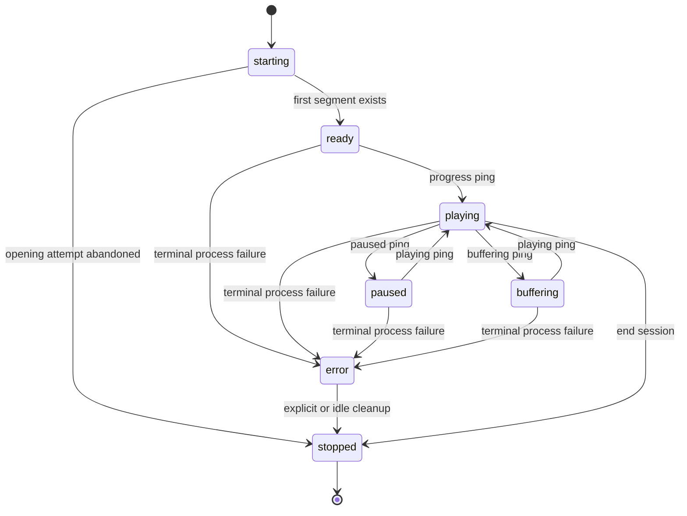

# Playback lifecycle

Active contributors: VeroxAUS

The manager owns session processes, files and source leases. It serializes seek/track restarts, monitors idle sessions and disk use, and stops a session if any managed FFmpeg exceeds its memory limit (`apps/server/src/playback/manager.ts`).

## Layout and key abstractions

`SessionRecord` in `apps/server/src/playback/session.ts` stores public state separately from process state: generation, current run start/head, restart promise, parked flag, playhead and activity timestamps. `EncoderProcess` in `apps/server/src/playback/encoderProcess.ts` owns one child; `SegmentStore` in `apps/server/src/playback/segmentStore.ts` indexes finished files; `SessionMonitor` in `apps/server/src/playback/monitor.ts` applies the pure disk planner; `MemoryWatchdog` in `apps/server/src/playback/memoryWatchdog.ts` samples process working sets; `PidRegistry` in `apps/server/src/playback/pidRegistry.ts` records children for crash recovery.

The diagram abbreviates transitions: pings can move any ready/playing/paused/buffering record to any ping state; stop applies to every state. Seeking, retrying and parking are internal process operations, not public states (`apps/server/src/playback/manager.ts`, `apps/server/src/playback/session.ts`).

Opening sessions remain hidden from list/activity until the first segment. [Startup](index.md) describes candidate fallback and two-slot reservation; this page covers behavior after a record exists.

## Segment serving and seek restarts

The initial segment is `floor(startPositionSec / 4)`, clamped to the final segment. Playlists still enumerate the complete title. For a requested video segment (`apps/server/src/playback/manager.ts`):

1. Wait for any current track reconfiguration; set `playerSegment`. If no progress ping arrived in 30 seconds, also infer reported position from that segment.
2. Serve an existing finished file without forcing a restart.
3. For a missing file, keep the running encoder only if the index is at/after its run start and lies between **head−1** and **head+5**.
4. Otherwise increment generation, stop the old child and launch at the requested segment. A shared restart promise serializes operations; callbacks from old generations are ignored.
5. Poll for the final file every **100 ms**, up to the default **30-second** deadline. A skipped/evicted target can trigger another ensure/restart, up to **3 serving attempts**.

A wait timeout is 504 `segment_timeout`; terminal encoder failure is 502 with its code; clean completion without that file is 404. No `.tmp` segment is served. Each launch resets the [read-ahead window](../network.md) and recent-speed history. The manager intends one video encoder per session, apart from independent subtitle workers.

Heavy-source extractor warm-up is reevaluated against the new video run's `startSegment`, not the title's absolute segment zero. Subtitle stores and running extraction workers survive a video restart. Their recorded warm timestamp is per extractor run and is set only once, so restarting video does not automatically grant an existing worker another fresh burst (`apps/server/src/playback/manager.ts`, `apps/server/src/playback/subtitleExtractor.ts`). See [subtitle scheduling](subtitles.md#heavy-source-warm-up-and-the-burst-clock).

### Safe fMP4 init

FFmpeg creates `init.mp4` before it is complete. The manager waits for a run with a finished first segment, copies init to a temporary file, verifies generation is unchanged and renames it to `init-ready.mp4`. Ordinary seeks reuse that complete copy; audio/burn reconfiguration deletes it. `frag_discont` preserves absolute timestamps across runs, as described in [encoding](encoding.md) (`apps/server/src/playback/manager.ts`).

### Track changes

PATCH validates requested choices before mutation. Text-only selection changes do not restart video. A changed audio index or bitmap burn target recalculates the decision, updates play history, stops video, removes prior `.ts`/`.m4s` segments and the ready init, clears accounting, and launches at the current position's segment. Playlist URLs remain stable; the client must reload changed media. Failed records reject PATCH with 409 `session_failed`. The subtitle cue store/controller survives video restarts (`apps/server/src/playback/manager.ts`, `apps/server/src/playback/tracks.ts`).

## Ordinary encoder recovery

The first unexpected nonzero exit refreshes the source link best-effort and relaunches near the first missing segment. `resumePoint()` scans from `max(runStart, head−6)` past finished files, bounded by the final segment. A seek or track reconfiguration resets this one-retry allowance (`apps/server/src/playback/manager.ts`).

If a tone-mapped libplacebo run fails before its first segment, that session switches to OpenCL and the manager remembers libplacebo as broken for later sessions. It still uses NVENC; another source is tried only during automatic startup, not mid-session.

A second unexpected failure sets state `error`. For an already-visible session it finalizes failed play history, emits an error and updates activity. The record, files, source lease and subtitle controller are **not immediately deleted**; explicit stop, idle cleanup or shutdown owns teardown. An opening failure instead lets startup abandon the attempt and delete its provisional history. Error text strips URL-like strings and registered secrets (`apps/server/src/playback/manager.ts`).

## RSS watchdog and CPU protections

`FFMPEG_MAX_RSS_MB` defaults to **4096 MiB per process**. The manager shares one watchdog across video and subtitle FFmpeg children. It samples watched PIDs every **1 second**; Windows uses `tasklist` working sets, other platforms use `ps` RSS. A process is over the limit only when usage is **strictly greater**. Missing/failed samples skip that round, and overlapping sampling is suppressed (`apps/server/src/playback/memoryWatchdog.ts`).

A video **or subtitle** limit hit fails the whole session immediately as `encoder_memory_limit`, invalidates the process generation, records the error and stops its video/subtitle children. It does not take the ordinary retry path. The offender is asked to quit with `q`, then killed after a **2-second** grace. The session's error record/files still await normal teardown; an opening failure is abandoned by startup (`apps/server/src/playback/manager.ts`, `apps/server/src/playback/encoderProcess.ts`).

This is a sampled per-process guard, not a hard aggregate memory quota, GPU-VRAM limit or Node.js RSS limit. Probing is not enrolled in this watchdog. Video/extraction/probing use best-effort below-normal process priority; encoder/filter threads are capped separately in [encoding](encoding.md) (`apps/server/src/playback/priority.ts`).

## Idle and disk housekeeping

The default tick is **2 seconds**; overlapping sweeps are suppressed. It first ends records inactive for **120 seconds**, including failed records but excluding opening ones. HLS, subtitle and progress requests count as activity; GET session metadata does not. It refreshes live finished-file sizes, estimates bitrate from up to ten recent segments and applies disk policy (`apps/server/src/playback/monitor.ts`, `apps/server/src/playback/manager.ts`).

`TRANSCODE_MAX_GB` defaults to **20**, interpreted as `20 × 1024³` bytes. Only finished `seg-N.ts`/`seg-N.m4s` sizes feed this planner; temporary files, init, subtitle output and other overhead do not. It is **not a filesystem quota** (`apps/server/src/config.ts`, `apps/server/src/playback/segmentStore.ts`).

| Stage       | Policy in `apps/server/src/playback/diskCap.ts`                                                          |
| ----------- | -------------------------------------------------------------------------------------------------------- |
| Usage >80%  | Oldest-activity sessions first: evict segments `< player−3`, aiming for 65%                              |
| Still >80%  | Park running encoders with at least 8 segments/32 seconds of lead                                        |
| Usage >100% | Stop sessions idle ≥30 seconds, oldest first, never the last remaining session                           |
| Still >100% | Evict from largest remaining sessions toward 65%, protecting player through player+5 and indexes ≥head−2 |
| Usage <60%  | Resume parked encoders with less than 30 segments/120 seconds of lead                                    |

Protected data or insufficient candidates can leave usage above the cap. New writes can also arrive between ticks. A missing video request can restart a parked encoder without waiting for the monitor; evicted positions stay in the VOD playlist and are regenerated. Disk parking stops a process; network read-ahead holding keeps its loopback connection alive. They are different controls.

## Teardown and crash recovery

Ending marks stopping, removes the record, waits for any restart, stops video/subtitles, releases its source owner and removes its directory with retries. Nonfailed play history is finalized as `ok` for stop/idle/disk/shutdown; an existing failure is preserved. It emits `session.end` with the reason (`apps/server/src/playback/manager.ts`).

Ordinary process stop sends `q`, waits **3 seconds**, then force-kills, with a further bounded wait. Windows uses `taskkill /T /F`; POSIX kills the recorded PID. The stderr tail is limited to **4,000 characters** and is scrubbed before user/log exposure (`apps/server/src/playback/encoderProcess.ts`).

Startup reads `ffmpeg-pids.json` under the configured data directory. A recorded PID is killed only if its current command line contains the recorded match: video defaults to session ID; subtitle runs use the `webvtt` marker. Entries are then removed. Persistence is best-effort; this is a safety check, not a universal process-identity guarantee (`apps/server/src/playback/pidRegistry.ts`).

Recovery also deletes **every child directory under the configured transcode directory**, not just UUID-shaped ones. Keep unrelated data out of that directory. Locked cleanup failures may remain until a later startup. Server startup/shutdown ownership is covered in [server](../../apps/server.md).

## Modification and test pointers

Preserve generation and restart ordering when changing `apps/server/src/playback/manager.ts`; change disk rules in the pure planner, working-set sampling in the watchdog and orphan matching in the PID registry. See [monitoring](../../how-to-monitor/index.md) for the startup timeline, events and operational warnings.

Playback footprint at `7eb94ba`: **27 source `.ts` files** under `apps/server/src/playback`, **24 `*.test.ts` files** under `apps/server/test/playback` and `apps/server/test/encode`, and **4 non-test TypeScript helpers** in those test directories. Test/code file ratio is **24/27 = 0.89**; scoped default-branch history has **1 unique human committer**, VeroxAUS, excluding bots. Integration files elsewhere are excluded. Offline tests cover reservations, fake-process failure and RSS decisions; GPU lifecycle tests cover real seeks, idle expiry, disk parking and residue. They were inspected, not run; their time limits are not measured benchmarks.

## Key source files

| Repository-root path                               | Role                                               |
| -------------------------------------------------- | -------------------------------------------------- |
| `apps/server/src/playback/manager.ts`              | Serving, restart, terminal failure and teardown    |
| `apps/server/src/playback/encoderProcess.ts`       | Child lifecycle, progress and bounded stderr       |
| `apps/server/src/playback/memoryWatchdog.ts`       | Per-PID working-set guard                          |
| `apps/server/src/playback/monitor.ts`              | Serialized housekeeping                            |
| `apps/server/src/playback/diskCap.ts`              | Pure eviction/park/resume plan                     |
| `apps/server/src/playback/segmentStore.ts`         | Finished-segment accounting                        |
| `apps/server/src/playback/pidRegistry.ts`          | Crash registry and stale-directory cleanup         |
| `apps/server/test/playback/memoryWatchdog.test.ts` | Sampling, threshold and graceful/forced stop tests |
| `apps/server/test/playback/diskCap.test.ts`        | Disk-protection thresholds                         |
| `apps/server/test/encode/lifecycle.test.ts`        | Real-media lifecycle expectations                  |
| `apps/server/test/encode/memory-limit.test.ts`     | Session failure on watchdog hit                    |
