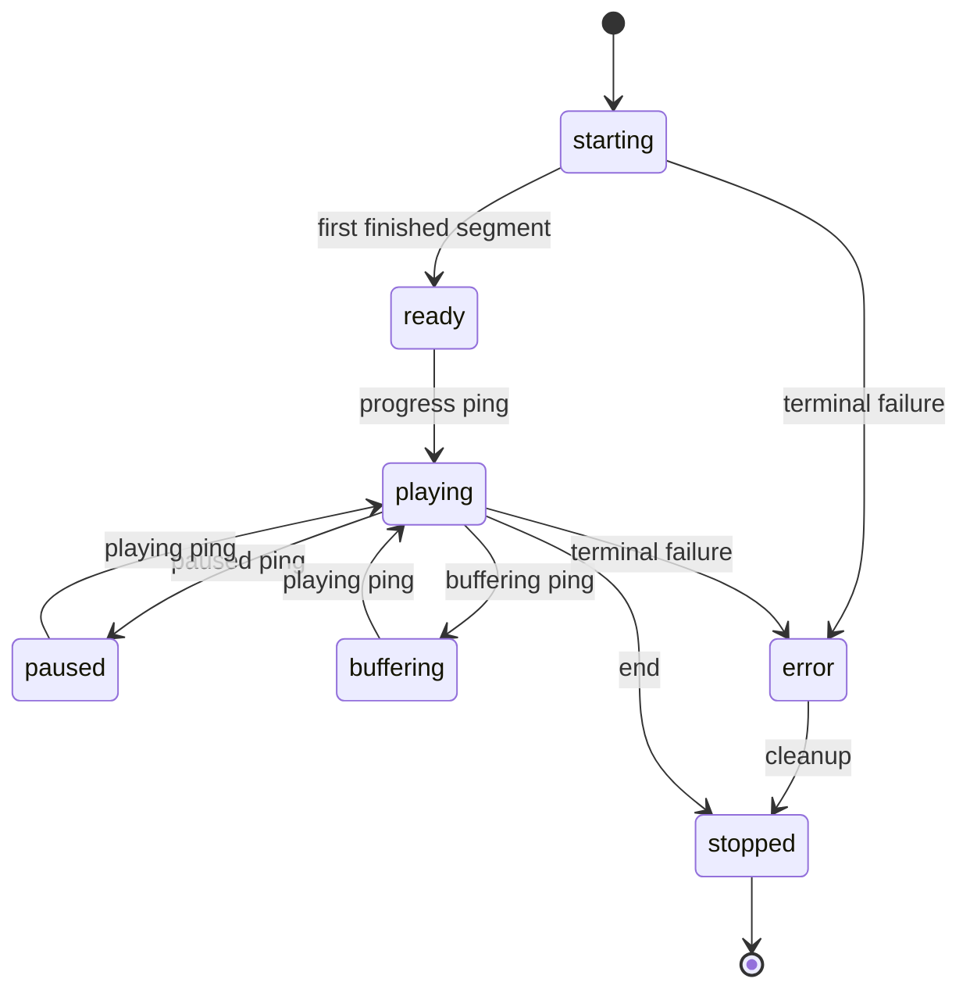

# Playback lifecycle

Active contributors: VeroxAUS

A session cannot replace its video encoder until the previous child has actually exited. `SessionSlots` in `apps/server/src/playback/sessionSlots.ts` retains capacity across opening, live, failed-but-running and draining work; `Recovery` in `apps/server/src/playback/recovery.ts` serializes replacements.

## Purpose

Keep public session state, GPU/process ownership and temporary output consistent during seeks, failures and shutdown. A resolved stop call and a removed API record do not prove a child is gone. Return to [playback](index.md) for admission/startup.

## State and ownership

`SessionRecord` in `apps/server/src/playback/session.ts` stores public starting/ready/playing/paused/buffering/error/stopped state separately from opening, parked, restart and generation flags.

This is abbreviated: stop applies to every state, and any ready/ping state can adopt the next ping state. Failed records leave active activity but can remain inspectable.

Admission defaults to **two video-session places**. Reservations count before metadata/proxy work; opening records are not counted twice. Ending removes the public record but holds a draining place while stopping. If a child survives, that place remains until its exit promise settles, and directory deletion is deferred. Failed-but-running records consume capacity too. An abandoned opening encoder can therefore block both a new start and automatic fallback.

## Checked stops and serialized replacement

`EncoderProcess` in `apps/server/src/playback/encoderProcess.ts` first sends q. Ordinary end, shutdown and disk parking use **3000 ms grace**; discarded-output seek/track/abandon operations use **1000 ms** and cut input before q. `killUntilExited` in `apps/server/src/playback/killUntilExited.ts` retries at most **three kills**, each with a **5000 ms exit wait**. These child bounds are distinct from the server's overall [shutdown deadline](../../apps/server.md#startup-and-shutdown).

`stopDiscarded` in `apps/server/src/playback/discardStop.ts` checks `running` after stop. A survivor produces **503 `encoder_not_stopped`**, not a replacement. `InputCuts` in `apps/server/src/sourceproxy/inputCuts.ts` destroys only that owner's main-reader responses and refuses reconnects until launch reset; extractor readers and other sessions are unaffected.

`recordStuckStop` in `apps/server/src/playback/stuckStop.ts` emits one error per process/reason and a later exit event with session/reason/timing, not secret inputs or file paths.

Seek, retry and track changes share the record's restart promise. Generation checks ignore stale exit/progress callbacks. Failure retry includes its source-refresh wait inside the serialized operation, preventing a concurrent HLS request from launching beside it. Stop notification abandons that wait without requiring the remote lookup itself to cancel.

## HLS, seeks and tracks

`HlsServing` in `apps/server/src/playback/hlsServing.ts` serves finished files immediately. Missing distant/evicted segments trigger recovery at their requested index. A running encoder is considered able to produce indexes from **head−1 through head+5**, at/after its run start. Default file waits are **30 seconds**; lost-segment handling allows up to three serve attempts.

A backward request more than two segments before the last requested segment updates position immediately, avoiding a stale forward ping. Seek recovery aligns position and notifies subtitle scheduling.

Audio changes and bitmap burn-target changes discard incompatible segments/init and restart at the reported position; text-only changes do not restart video. `PlaybackManager.patch` in `apps/server/src/playback/manager.ts` restores audio, subtitle, default provenance and stored decision if restart is refused.

`masterAudioChannels` in `apps/server/src/playback/decision.ts` advertises the maximum device-compatible channel count across source audio tracks, rather than the selected track. Audio-only switches therefore keep master bytes stable, while encoded AAC still follows the selected track. This is not a guarantee that explicit subtitle changes leave master defaults unchanged.

For fMP4, the server copies init only after a run finishes its first segment, verifies generation, then atomically renames the copy. It never serves a half-written encoder init. See [encoding](encoding.md).

## Recovery and safeguards

| Control                  | Behavior                                                                                                                   |
| ------------------------ | -------------------------------------------------------------------------------------------------------------------------- |
| Unexpected video exit    | Refresh source and retry once; another failure is terminal                                                                 |
| Early libplacebo failure | Select alternate color filters and remember for later sessions                                                             |
| Per-process RSS watchdog | Default **4096 MiB**, sampled every second; a hit fails the whole session and stops video/subtitles without ordinary retry |
| Idle cleanup             | Default **120 seconds** inactivity; monitor every **two seconds**                                                          |
| Disk planning            | Evict, park/resume, and if needed stop older idle sessions                                                                 |

`MemoryWatchdog` in `apps/server/src/playback/memoryWatchdog.ts` samples tracked children together; `lowerPriority` in `apps/server/src/playback/priority.ts` best-effort lowers FFmpeg/ffprobe priority. Neither is a CPU/GPU quota.

`SessionMonitor` in `apps/server/src/playback/monitor.ts` refreshes `SegmentStore` in `apps/server/src/playback/segmentStore.ts`, derives bitrate from finished segments, applies disk policy and publishes updates. Pings, including paused pings, plus media/subtitle requests count as activity.

`planDiskCap` in `apps/server/src/playback/diskCap.ts` starts trimming above **80%** toward **65%**, retaining three behind-player segments where possible. If pressure remains it parks encoders at least eight segments ahead. Above cap it may stop sessions idle for 30 seconds, but never the final remaining session, then trim unprotected segments. Resume requires usage below **60%** and lead below 30 segments. This finished-segment policy is not a strict limit on every temporary file, nor the same as a [network read hold](../network.md).

`PidRegistry` in `apps/server/src/playback/pidRegistry.ts` records children for next-start crash recovery. Cleanup verifies the recorded session/custom marker in the live command line before killing a PID and clears stale transcode child directories. Extractors use their exact opaque input URL as marker in `apps/server/src/playback/subtitleRun.ts`, not the generic WebVTT output format.

## Modification entry points

Keep stop/exit distinctions in slot and process code, replacement ordering in `apps/server/src/playback/recovery.ts`, safe publication in `apps/server/src/playback/hlsServing.ts`, and pure disk planning in `apps/server/src/playback/diskCap.ts`. Coordinate changes with [subtitles](subtitles.md) and [source proxy](../source-proxy.md).

## Key source files

| File                                                               | Purpose                                            |
| ------------------------------------------------------------------ | -------------------------------------------------- |
| `apps/server/src/playback/sessionSlots.ts`                         | Admission, draining and deferred deletion          |
| `apps/server/src/playback/discardStop.ts`                          | Checked replacement stops                          |
| `apps/server/src/playback/recovery.ts`                             | Serialized retry/seek/track operations             |
| `apps/server/src/playback/hlsServing.ts`                           | File readiness and safe init                       |
| `apps/server/src/playback/encoderLifecycle.ts`                     | Generation-aware launch/park/resume                |
| `apps/server/src/playback/pidRegistry.ts`                          | Crash ownership registry                           |
| `apps/server/test/integration/playback-manager-stuck-stop.test.ts` | Deleted/abandoned/restarted survivors retain slots |
| `apps/server/test/integration/playback-manager-recovery.test.ts`   | Retry serialization, filters, memory and disk      |
| `apps/server/test/integration/playback-manager-restart.test.ts`    | Grace/cut ordering and shutdown during refresh     |

## Measured scope

At **`0a8f04f`**, scoped `git ls-tree` counts **42 playback `.ts` source / 35 playback-plus-encode `*.test.ts` files**, ratio **0.83**. Helpers and integration elsewhere are excluded; this playback-wide scope overlaps other playback pages. CODEOWNERS and supplied default-branch history identify **1 unique human**, excluding bots, not an ownership guarantee. No application tests or encoders were launched.
