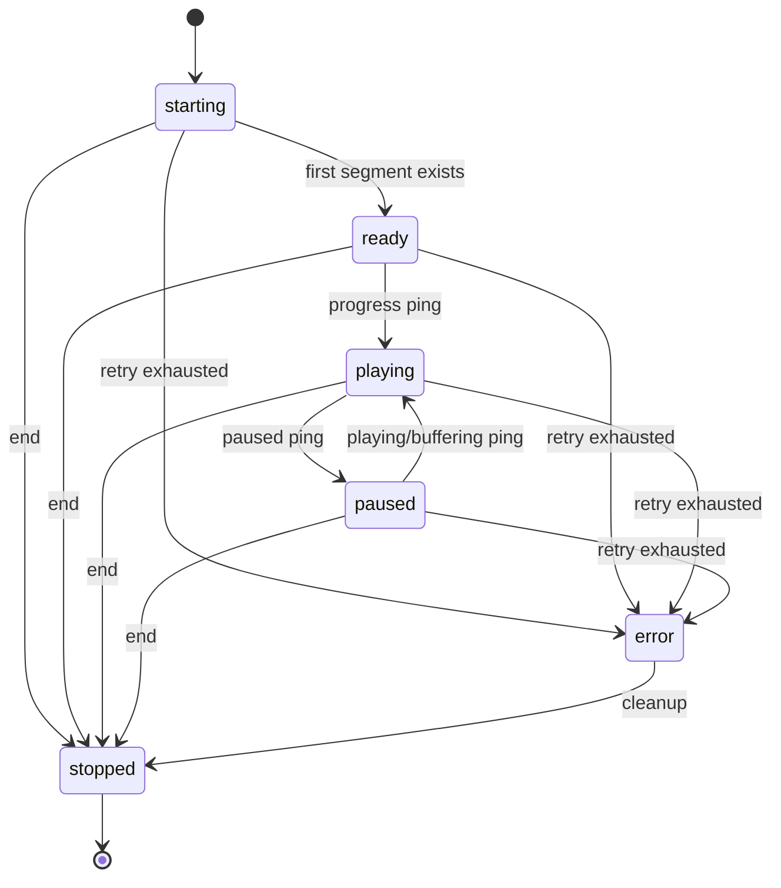

# Playback lifecycle and recovery

Active contributors: VeroxAUS (origin/main sole human)

The playback manager owns session resource lifetime, serializes video restarts, and uses a periodic monitor to reconcile client activity, finished-segment disk usage, and encoder progress. A complete HLS playlist does not require encoding the whole title in advance.

## Layout and key abstractions

`SessionRecord` stores state, a generation token, restart promise, current run start/head, player segment, activity timestamps, and a parked flag. `EncoderProcess` wraps a child process; `SegmentStore` indexes finished media files. `SessionMonitor` applies a pure `planDiskCap` result to live sessions. `PidRegistry` is the crash-recovery safety net.

Seeking/retry/parking are process operations, not separate public session states. A paused client can keep a session alive with pings; polling session metadata alone does not count as activity.

## Seeking and segment serving

The initial run starts at `floor(startPositionSec / 4)`, clamped to the final segment. Generated playlists still list every segment from zero. Segment requests update `playerSegment`; if no progress ping arrived in 30 seconds, they also set the reported position to that segment's start.

1. A finished requested file is served without forcing a restart.
2. For a missing file, a running encoder is considered close enough only when the target is at/after its run start, at least `head − 1`, and at most `head + 5`.
3. Otherwise `restartAt` invalidates old callbacks by incrementing generation, stops the prior video child, resets the failure allowance, and launches at the requested index. Restart promises serialize these operations.
4. A request waits for a final file (not `.tmp`), polling every **100 ms** with a default **30-second** deadline.
5. If the target was skipped/evicted while waiting, serving can ensure/restart again, up to **3 attempts**. A timed-out wait produces 504 `segment_timeout`; a failed encoder produces 502 `encoder_failed`; a completed run that never produced it produces 404.

Only one video encoder is intended per session; independent subtitle workers can also exist. Generation checks suppress progress/exit callbacks from replaced video runs.

For fMP4, `init.mp4` is not served as soon as FFmpeg creates it: the manager waits for the current run's first finished segment, copies init to a temporary file, verifies generation stayed unchanged, then renames to `init-ready.mp4`. Ordinary seeks reuse that complete init; track reconfiguration discards it because audio parameters may change. Absolute fragment timestamps are maintained by [encoding flags](encoding.md).

## Track reconfiguration

PATCH validates all supplied choices before mutation. Text-only changes do not alter encoded media. A changed audio index or bitmap burn target recalculates the decision, updates the play record, stops video, removes old `.ts`/`.m4s` output and `init-ready.mp4`, clears segment accounting, and launches at `floor(positionSec / 4)`. The playlist URL and segment naming stay stable; clients must reload playback after a media-changing selection. [Subtitle workers and their cue store](subtitles.md) persist.

## Process failure and recovery

The first unexpected nonzero exit emits a warning, refreshes the proxy's upstream resolution (refresh errors are tolerated here), and relaunches near the first missing segment. `resumePoint` scans from `max(runStart, head − 6)` past existing segments, bounded by the final index.

If a tone-mapped libplacebo run fails before producing its first segment, recovery switches that session to OpenCL and marks libplacebo broken for future sessions on that manager instance. This is failure-triggered fallback, not prior hardware validation; there is no software video-encoder fallback.

A second unexpected failure in that retry allowance sets state `error`, finalizes the play as failed, emits an error log/event and `session.update`, and removes it from live activity/slot accounting. It **does not immediately delete the record, source handle, subtitle workers, or output directory**; explicit stop, idle cleanup, or shutdown performs teardown. Error details scrub URL-like strings and redact registered secrets.

`EncoderProcess.stop()` first writes `q` and closes stdin, waits up to **3 seconds**, then force-kills (Windows `taskkill /T /F`; non-Windows SIGKILL to the recorded PID), with a further bounded wait. Stderr is retained only as the last **4,000 characters**.

## Disk-cap flow

Housekeeping defaults to **2-second** ticks; overlapping ticks are suppressed. It first ends all sessions inactive for **120 seconds**, including failed records, refreshes live finished-segment sizes, derives bitrate from up to ten recent segments, applies disk policy, and publishes updates.

The cap is `transcodeMaxGb × 1024³`, using the sizes of completed `seg-N.ts`/`seg-N.m4s` files. It is **not a hard filesystem quota**: `.tmp`, init, playlists, subtitle outputs, and other directory overhead are not counted by this planner, and new data can arrive between ticks.

| Stage | Rule |
| --- | --- |
| Above 80% | Oldest-activity sessions first: evict watched segments with index `< player − 3`, targeting 65% |
| Still above 80% | Park running encoders with at least 8 segments (32 s) lead, retaining output |
| Above 100% | Stop sessions idle at least 30 s, oldest first, never the last remaining session |
| Still above 100% | Evict from largest remaining sessions toward 65%, protecting player through player+5 and indexes at/after head−2 |
| Below 60% | Resume a parked encoder if head−player is less than 30 segments (120 s) |

Protected regions or insufficient candidates can leave planned usage above the cap. The ratios provide headroom/hysteresis, not guaranteed exact disk bounds. Evicted files remain in the VOD timeline and can be regenerated on request. A missing requested segment can restart a parked encoder directly, independently of monitor resume thresholds.

## Teardown and startup orphan recovery

Ending marks the record stopping, removes it from the manager, waits for an in-flight restart, stops video and subtitles, releases the source owner, and removes the session directory with retries. Nonfailed plays are finalized as `ok` for stop/idle/disk/shutdown; failed history is preserved. `session.end` includes the reason.

At server startup, recovery reads `dataDir/ffmpeg-pids.json`. Video entries default to matching their session ID in the command line; extractor entries use the **`webvtt` marker**, not a session-ID match. Only matching recorded PIDs are killed, then registry entries are removed. Windows command lines come from CIM; non-Windows from `ps`.

Recovery also attempts to delete **every child directory** under the configured transcode directory, not just UUID-shaped ones. Keep unrelated data out of that directory. Registry persistence is best effort, and cleanup failures may leave locked directories for the next startup. This protects against many recycled-PID cases but is not a universal guarantee of child-process identity.

## Integrations and modification entry points

Session and event contracts are covered by the [API](../../api/index.md), persistence by [data models](../../reference/data-models.md), and upstream retries by the [source proxy](../source-proxy.md). Change restart rules in `apps/server/src/playback/manager.ts`; disk decisions in `apps/server/src/playback/diskCap.ts`; accounting/tick behavior in `apps/server/src/playback/monitor.ts`; process shutdown/identity checks in `apps/server/src/playback/encoderProcess.ts` and `apps/server/src/playback/pidRegistry.ts`.

## Measured scope and test evidence

Shared playback footprint: **20 source `.ts` / 16 `*.test.ts` / 2 helper `.ts` files**, recursive working-tree counts under playback source and playback/encode test directories; **1 unique committer** from `origin/main` `%cn <%ce>` scoped to those directories. Counts refer to the whole playback subsystem.

`apps/server/test/encode/lifecycle.test.ts` asserts far/backward seeks, concurrent-start reservations, idle behavior, one retry, disk parking, and residue cleanup. Its timings are test expectations, **not benchmarks measured for this wiki**. `apps/server/test/playback/diskCap.test.ts` expresses eviction/protection thresholds; `apps/server/test/playback/pidRegistry.test.ts` covers registry/orphan expectations. Tests were read, not executed.

## Key source files

| Repository-root path | Role |
| --- | --- |
| `apps/server/src/playback/manager.ts` | Serving, restarting, failing, and ending |
| `apps/server/src/playback/encoderProcess.ts` | Child-process lifecycle |
| `apps/server/src/playback/monitor.ts` | Serialized housekeeping |
| `apps/server/src/playback/diskCap.ts` | Pure cap policy |
| `apps/server/src/playback/segmentStore.ts` | Finished-file accounting |
| `apps/server/src/playback/pidRegistry.ts` | Persistent PID registry and startup cleanup |
| `apps/server/test/encode/lifecycle.test.ts` | Lifecycle integration expectations |
| `apps/server/test/playback/diskCap.test.ts` | Disk planning cases |
