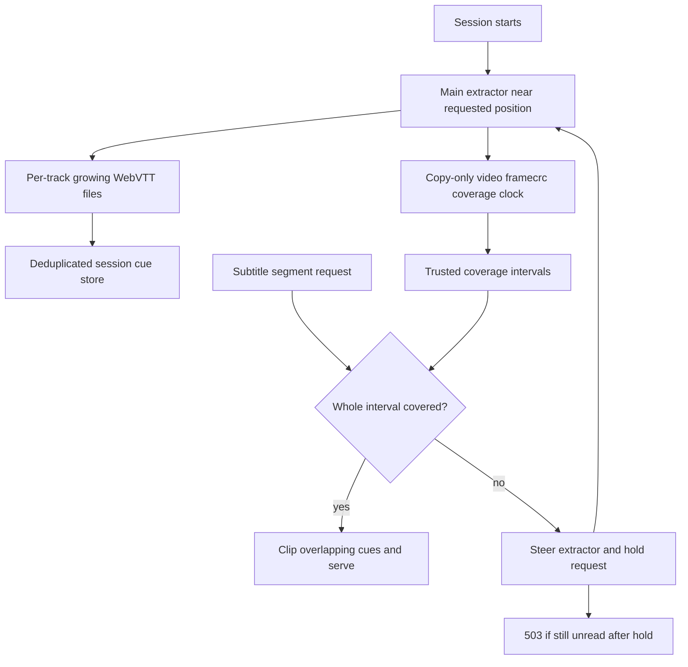

# Progressive subtitles and burn-in

Active contributors: VeroxAUS (origin/main sole human)

Text subtitles are progressively extracted to WebVTT independently of the video encoder. Picture-based subtitles are rendered into video on request. The two modes have different seek, restart, and readiness semantics.

## Layout and key abstractions

| Module | Responsibility |
| --- | --- |
| `apps/server/src/playback/tracks.ts` | Validate text/sidecar versus bitmap/burn choices |
| `apps/server/src/playback/subtitleExtractor.ts` | Schedule main, seek, and gap-fill runs |
| `apps/server/src/playback/subtitleRun.ts` | One FFmpeg, growing VTT readers, coverage clock |
| `apps/server/src/playback/subtitleStore.ts` | Session-owned deduplicated cues and union of trusted coverage |
| `apps/server/src/playback/vtt.ts` | Parse growing cue blocks and render full/segmented output |
| `apps/server/src/playback/intervals.ts` | Half-open coverage unions and gap detection |

Probe recognizes SubRip/SRT, ASS/SSA, mov_text, WebVTT, and text as text tracks; PGS, DVD, DVB, and XSUB as bitmap tracks. Other subtitle codecs are omitted. At most **10 text tracks** get renditions: when over the cap, English is prioritized, then the selected tracks retain source order. Bitmap tracks remain listed without a text URL.

## Text extraction flow

The main run starts with video encoding, at `max(0, floor(requestedStartSec − 40))`. Each run reads the source once and emits every selected text track. An extra copy-only video `framecrc` output provides the clock: sparse forced/signs subtitles cannot reliably drive FFmpeg's usual output progress. `-copyts` preserves absolute source times.

Runs tail outputs every **250 ms**, retaining UTF-8 decoder state and unfinished cue blocks. A complete newline-terminated newest cue can be accepted without waiting for another blank separator. Coverage is committed only after reading the growing track files against a sampled video head.

### Coverage and seeks

- Nonzero seeks trust coverage from `ss + 10 seconds`; zero-start trusts from zero. This guards against cues that started before the input seek.
- Live coverage ends at `committedHeadSec − 6 seconds` to allow for container-cluster/read lag.
- Clean completion covers through infinity; the store intersects that with requested media intervals. Full completion tolerates less than 0.5 seconds missing at the end.
- Coverage is the union over runs, not inferred from cue presence. A covered silent segment may correctly contain no cues; an unread segment must not masquerade as silence.
- A request within **120 seconds** ahead of a relevant active run waits for it. Otherwise a seek run begins 40 seconds before the target.
- At most **2 extractor processes** run at once. Seeking replaces a non-main run preferentially, and waits for it to stop before launching. A delayed fill run reads the first uncovered gap after main has progressed at least **60 seconds**, subject to available slots.
- Overlapping runs hand over after the earlier one reads **10 seconds** into the later run's trusted territory. Completed coverage stops remaining work.

The store deduplicates by start/end/text, sorts deterministically, and keeps cue settings for rendering. Cues crossing four-second segment boundaries are clipped into each interval, retaining **absolute** times and `X-TIMESTAMP-MAP=MPEGTS:0,LOCAL:00:00:00.000`. Full-track VTT retains original cue times without that map.

## Readiness and failures

Master and subtitle playlists are duration-derived complete VOD manifests and never wait for extraction. Each text rendition is explicitly `DEFAULT=NO,AUTOSELECT=NO`; choosing a sidecar records selection without restarting video.

| Request condition | Result |
| --- | --- |
| Trusted segment interval covered | 200 WebVTT, including legitimate empty coverage |
| Unread interval | Steer extraction, poll up to default **6 seconds**, then 503 `subtitle_not_ready`, `Retry-After: 1`, `Cache-Control: no-store` |
| Extraction permanently failed, interval unread | Header-only WebVTT with `X-Subtitle-Status: failed` |
| Full track not complete | 404 `subtitle_not_ready`; `fullUrl` remains null |
| Full track complete | `fullUrl` exposed; serve full VTT |
| Unrendered/unknown track or out-of-range segment | 404 |

A failed run retries once, starting 40 seconds before its committed head. A second failure marks unfinished extraction as error, logs a warning, and stops active runs. Already-covered intervals remain usable; subtitle failure is not itself a video-session failure. The failed-empty response is a distinct explicit failure path, not the normal not-ready behavior.

## Bandwidth integration

Extractors use `SourceHandle.extractorUrl`, sharing cached source bytes with the encoder but **not populating the rolling block cache**. Only upstream extractor traffic is throttled, to **2 MiB/s** while starved; memory reads remain fast.

Video normally marks the shared source starved with less than 30 seconds of lead, or positive recent speed below 1.6×. A new main/seek burst relaxes this until it reaches 72 seconds beyond its needed position or 25 seconds wall time, unless positive video speed falls below 1.35×. These are scheduling heuristics, not a guaranteed realtime performance floor. See [source proxy](../source-proxy.md).

## Bitmap burn-in and track changes

`requireSubtitle` rejects bitmap sidecar and text burn modes. A bitmap selection maps its stream into an overlay graph and passes the authored canvas when known. Video first scales/tone-maps, then overlays subtitles. HDR10 subtitle RGB white is multiplied by **0.58**, targeting SDR-reference-white PQ rather than full-scale HDR white.

The inspected working tree uses NVDEC plus CUDA scale and download for compatible retained-HDR output of width ≥3840; subtitle RGBA is rendered at 1920×1080 and neighbor-upscaled. Other burn-in paths use software decode/scale as appropriate, while video encoding remains NVENC. Tone mapping itself still uses Vulkan/libplacebo or OpenCL filters; “software decode” is not “software tone mapping.”

Audio changes or enabling/disabling/changing bitmap burn-in restart the video process at the current playhead segment and discard prior video segments and the ready init copy. **Text extractor state survives** these restarts. Burn runs start up to ten seconds early and trim lead-in so an already-visible bitmap cue survives a seek; this is a bounded preroll heuristic.

## Modification entry points

Change supported kinds in `apps/server/src/playback/probe.ts`, selection semantics in `apps/server/src/playback/tracks.ts`, scheduler limits in `apps/server/src/playback/subtitleExtractor.ts`, and trust boundaries in `apps/server/src/playback/subtitleRun.ts`. Preserve the distinction between missing data and silent coverage when changing serving logic in `apps/server/src/playback/manager.ts`. Public URLs belong to the [API](../../api/index.md); video output requirements belong to [encoding](encoding.md).

## Measured scope and evidence

Shared playback scope: **20 source `.ts` / 16 `*.test.ts` / 2 helper `.ts` files**, recursively enumerated under `apps/server/src/playback`, `apps/server/test/playback`, and `apps/server/test/encode`; **1 unique committer** in scoped `origin/main` history, deduplicating `%cn <%ce>`. This is the full playback footprint, not subtitle-only allocation.

Read evidence includes cue parsing/coverage tests, progressive integration assertions for late-start equivalence, holding and retrying unread segments, no extractor restart on PATCH, and bitmap preroll. Tests were **not run**. The encoding argument file and its unit test already had uncommitted edits; documentation did not alter them.

## Key source files

| Repository-root path | Role |
| --- | --- |
| `apps/server/src/playback/subtitleExtractor.ts` | Bounded run scheduling and retries |
| `apps/server/src/playback/subtitleRun.ts` | Framecrc clock and incremental cue reads |
| `apps/server/src/playback/subtitleStore.ts` | Coverage and stable cue set |
| `apps/server/src/playback/vtt.ts` | Timestamp and clipping rules |
| `apps/server/src/playback/ffmpegArgs.ts` | Bitmap overlay and preroll |
| `apps/server/test/playback/subtitles.test.ts` | Cue, interval, and playlist expectations |
| `apps/server/test/encode/progressive-subtitles.test.ts` | Progressive readiness/lifetime assertions |
| `apps/server/test/encode/tracks.test.ts` | Audio and burn-in switch assertions |
