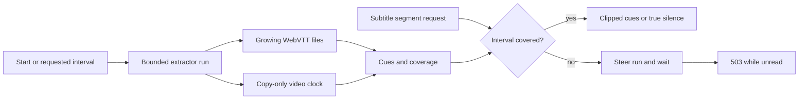

# Subtitles

Active contributors: VeroxAUS

Text tracks become progressive WebVTT renditions; bitmap tracks burn into video. `SubtitleHandoff` in `apps/server/src/playback/subtitleHandoff.ts` connects HTTP readiness to `SubtitleExtractor` in `apps/server/src/playback/subtitleExtractor.ts` and session-owned `SubtitleStore` in `apps/server/src/playback/subtitleStore.ts`.

## Purpose

Deliver useful cues near the playhead without scanning an entire remote title first. Covered silence and unread media are different: an empty successful response must not hide extraction that has not reached the requested interval. See [playback](index.md) and the [web player](../../apps/web/player.md).

## Selection and track contracts

`chooseDefaultSubtitle` in `apps/server/src/playback/defaultSubtitle.ts` runs only when start omits the subtitle field; explicit null means Off.

| Audio language    | Automatic choice                                                          |
| ----------------- | ------------------------------------------------------------------------- |
| English           | Forced English, otherwise Off                                             |
| Known non-English | Full English, then forced English                                         |
| Undetermined      | Apply the same rule using TMDB original language; Off if neither is known |

Text beats bitmap within the relevant pool. Default flags and non-SDH titles further rank candidates. A full bitmap English track can therefore beat a forced text track for non-English audio.

`requireSubtitle` in `apps/server/src/playback/tracks.ts` validates text/sidecar versus bitmap/burn modes. At most **10 text tracks** get renditions, preferring English when truncating while retaining the selected text track. `PlaybackManager.patch` in `apps/server/src/playback/manager.ts` clears automatic-default provenance for an explicit subtitle PATCH; an audio-only PATCH preserves the existing subtitle choice.

## Extraction and coverage

A fresh run starts **12 seconds before the four-second segment containing the target**, clamped to zero. `SubtitleRun` in `apps/server/src/playback/subtitleRun.ts` reads the source once for all selected text tracks plus a copy-only video framecrc output. The video packet clock, not sparse cue times or slowest-output progress, measures how far source data was read. Timestamps remain absolute.

Files are tailed every **250 ms**. Trusted coverage starts at zero for a zero-start run, otherwise **run start+10 seconds**. While running, it ends **six seconds behind committed video head**, after track-file reads. Clean completion covers onward from that trusted start; it does not invent earlier coverage.

`SubtitleStore` unions run intervals, deduplicates time/text cues and orders them deterministically. Full completion tolerates a final **0.5-second** duration-rounding gap. `renderSegment` in `apps/server/src/playback/vtt.ts` clips cues to four-second segments with an absolute timestamp map; `apps/server/src/playback/intervals.ts` supplies pure coverage/gap operations.

## Scheduling, pacing and lifetimes

A useful unheld run within **120 seconds** ahead is waited for rather than duplicated. Otherwise seek launches are serialized. On a video seek, irrelevant runs stop; later subtitle demand starts replacement work. A run more than 120 seconds behind player reach stops. Earlier gaps are filled on demand, not by an automatic full-prefix scan.

`maxExtractorRuns` in `apps/server/src/playback/extractorSchedule.ts` permits **two workers for light sources, one for heavy sources**. Heavy means height ≥2160 or estimated average source bitrate ≥45 Mbps. A stopping worker or one reading final output retains its place until exit is reported. Replacement must not overlap those places.

A failed run retries once from **20 seconds before committed head**, overlapping the failed run's coverage lag. A second failure marks unread intervals failed while leaving covered cues usable.

`ExtractorWindows` in `apps/server/src/playback/extractorWindow.ts` applies time hysteresis per run. The default window holds at **176 seconds** ahead (configured 180 minus four seconds pipeline allowance) and resumes below **120 seconds**. The [source proxy](../source-proxy.md) separately bounds extractor byte lead over its own session's encoder; neither bound is merely a fixed rate.

Local rate policy in `apps/server/src/playback/extractorSchedule.ts` proposes:

- Unlimited when video is done or at least 15 seconds ahead.
- **6 MiB/s** while a heavy encoder with little lead warms.
- During a fresh burst, unlimited unless known average speed is below **1.35×**, then **2 MiB/s**.
- Otherwise **2 MiB/s** with little lead.

Warm means ten produced segments, or at least three with preferred recent/average speed ≥2×. A fresh stretch ends at target+72 seconds or after **25 seconds** measured from the later of launch and heavy-encoder warm time.

The proxy raises finite rates to at least **20% of aggregate cap**; the shared gate protects at-risk video before that extractor priority share. These are policies, not throughput measurements. Cached bytes bypass local pacing but still obey reader holds. See [network controls](../network.md).

## HTTP and bitmap behavior

| Request state                          | Response                                                                       |
| -------------------------------------- | ------------------------------------------------------------------------------ |
| Rendition playlist                     | Duration-derived VOD playlist, no extraction wait                              |
| Covered segment                        | 200 with clipped cues, or genuinely empty silence                              |
| Unread segment                         | Wait up to six seconds; then 503 `subtitle_not_ready`, Retry-After 1, no-store |
| Unread segment after permanent failure | Header-only WebVTT, `X-Subtitle-Status: failed`                                |
| Full track before coverage completes   | 404 `subtitle_not_ready`; no `fullUrl` yet                                     |

Far-ahead demand outside the configured window does not start another run. A disconnected request can end its wait early. Covered output remains usable after an ordinary extractor failure; that failure does not fail video. An RSS watchdog hit is different and fails the whole session.

Text cues survive video restarts. Bitmap/audio changes require a checked serialized restart; text-only selection does not. `buildFfmpegArgs` in `apps/server/src/playback/ffmpegArgs.ts` frame-rate-limits bitmap canvases before scaling, overlays after video conversion and uses up to ten seconds of burn preroll. HDR overlays preserve 10-bit output. See [encoding](encoding.md) and [lifecycle](lifecycle.md).

## Modification entry points

Change automatic defaults separately from explicit validation. Preserve interval coverage when changing extraction and actual-exit slot retention when changing launch/retry. Keep unread readiness in handoff rather than synthesizing empty cues. Cross-runtime response changes belong in [shared contracts](../../packages/shared.md).

## Key source files

| File                                                         | Purpose                                   |
| ------------------------------------------------------------ | ----------------------------------------- |
| `apps/server/src/playback/defaultSubtitle.ts`                | Automatic selection                       |
| `apps/server/src/playback/subtitleExtractor.ts`              | Worker orchestration                      |
| `apps/server/src/playback/subtitleRun.ts`                    | One worker, tails and coverage clock      |
| `apps/server/src/playback/subtitleStore.ts`                  | Session cues/coverage                     |
| `apps/server/src/playback/subtitleHandoff.ts`                | HTTP readiness and failure behavior       |
| `apps/server/src/playback/extractorSchedule.ts`              | Heavy-source warm-up and rate policy      |
| `apps/server/test/playback/defaultSubtitle.test.ts`          | Language, forced and text/bitmap defaults |
| `apps/server/test/playback/subtitleExtractorPreroll.test.ts` | Segment-aligned start and retry overlap   |
| `apps/server/test/playback/extractorSchedule.test.ts`        | Rate/burst/worker limits                  |
| `apps/server/test/playback/subtitleRunRegistry.test.ts`      | Session-specific orphan marker            |

## Measured scope

At **`0a8f04f`**, scoped `git ls-tree` counts **42 playback `.ts` source / 35 playback-plus-encode `*.test.ts` files**, ratio **0.83**. This is playback-wide, overlapping the other playback pages; helpers and integration elsewhere are excluded. CODEOWNERS and supplied default-branch history identify **1 unique human**, excluding bots, not an ownership guarantee. Tests were inspected, not executed.
