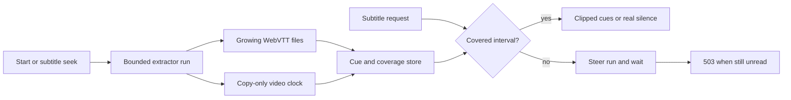

# Subtitles

Active contributors: VeroxAUS

## Purpose

Text tracks become progressive WebVTT renditions; bitmap tracks burn into video. `SubtitleHandoff` in `apps/server/src/playback/subtitleHandoff.ts` connects HTTP readiness to `SubtitleExtractor` in `apps/server/src/playback/subtitleExtractor.ts`, with session-owned cues in `SubtitleStore` in `apps/server/src/playback/subtitleStore.ts`.

## Selection and defaults

`chooseDefaultSubtitle` in `apps/server/src/playback/defaultSubtitle.ts` runs only when start omits subtitle selection. Explicit null means Off. English audio prefers forced English or Off; known non-English audio prefers full English, then forced English. Undetermined audio uses TMDB original language. Text is preferred within the relevant pool; forced/default/SDH metadata further orders candidates.

`apps/server/src/playback/tracks.ts` validates explicit selections: text sidecars and bitmap burn-in are distinct modes. At most **10 text tracks** get renditions, preferring English when truncation is needed and retaining the selected text track. Explicit subtitle PATCH clears automatic-default provenance; audio-only PATCH preserves the existing choice instead of rerunning defaults (`apps/server/src/playback/manager.ts`).

## Progressive extraction and coverage

A fresh run starts **12 seconds before the four-second segment containing the target**, clamped to zero. This is not the old 40-second preroll. It emits every selected text track in one FFmpeg read plus a copy-only video framecrc clock, preserving absolute timestamps (`apps/server/src/playback/subtitleRun.ts`).

Track files are tailed every **250 ms**. Trusted coverage starts at zero for a zero-start run, otherwise at start+10 seconds, and ends six seconds behind committed video head while running. Clean completion covers onward from that trusted start; it does not fill an earlier gap.

The store unions intervals across runs, deduplicates cues by time/text and sorts deterministically. Full completion tolerates the final 0.5 seconds of duration rounding (`apps/server/src/playback/subtitleStore.ts`). Covered empty intervals are silence; unread intervals must not masquerade as empty success.

## Scheduling and lifetimes

`apps/server/src/playback/subtitleExtractor.ts` waits for an unheld relevant run within 120 seconds of the requested point; otherwise it serializes a seek launch. Light sources allow two workers, heavy sources one (`apps/server/src/playback/extractorSchedule.ts`). Stopping or final-output-reading workers retain their process place until exit is reported. A replacement waits for those places rather than overlapping a stopping child.

On video seek, irrelevant runs are stopped; a later subtitle request creates useful replacement work. Runs more than 120 seconds behind player reach stop rather than continuously scan obsolete parts. Earlier gaps are filled on demand; there is no automatic full-prefix pass. Retry starts **20 seconds before committed head**, once, so its coverage overlaps the failed run's lag. A second failure marks unread areas failed but leaves covered cues usable.

`apps/server/src/playback/extractorWindow.ts` tracks per-run time holds. Handoff uses the configured read-ahead window minus four seconds of pipeline allowance; defaults therefore hold at **176 seconds**, resume below **120 seconds**. The proxy adds an independent byte-gap bound per owner/run; see [source proxy](../source-proxy.md).

## Bandwidth policy

Heavy means source height at least 2160 or estimated source bitrate at least **45 Mbps**. Warm means ten produced segments, or at least three with preferred recent/average speed at least 2× (`apps/server/src/playback/extractorSchedule.ts`).

When finished or at least 15 seconds ahead, video imposes no local extractor throttle. Below that lead, heavy warm-up proposes **6 MiB/s**; a fresh burst proposes unlimited unless known average speed is below 1.35×, then **2 MiB/s**; outside a burst it proposes 2 MiB/s.

The fresh stretch ends at target+72 seconds or **25 seconds** measured from the later of launch and first heavy-encoder warm timestamp. These are scheduling rules, not measured throughput guarantees.

`apps/server/src/sourceproxy/proxy.ts` raises finite proposed rates to at least **20% of the aggregate cap**. The shared gate prioritizes that extractor share only while no encoder is at risk below 15 seconds. Cached bytes bypass the rate pacer, but still obey reader holds. See [network](../network.md).

## HTTP and bitmap integration

`apps/server/src/playback/subtitleHandoff.ts` waits up to six seconds for an unread segment, then returns 503 `subtitle_not_ready`, Retry-After 1 and no-store. Far-ahead requests do not launch outside the window. Covered data returns 200; permanent extraction failure returns header-only WebVTT with `X-Subtitle-Status: failed` for unread intervals. Full-track URLs remain unavailable until complete.

Ordinary extraction failure does not fail video; a process RSS watchdog hit fails the whole session. Text cues survive video restarts. Bitmap/audio changes require serialized video restart; text-only choices do not (`apps/server/src/playback/manager.ts`).

`apps/server/src/playback/ffmpegArgs.ts` frame-rate-limits subtitle canvases before scaling, overlays after video conversion and uses a ten-second burn preroll. HDR overlays preserve 10-bit output. See [encoding](encoding.md) and [lifecycle](lifecycle.md).

## Modification entry points

Change defaults separately from explicit validation. Preserve coverage accounting when changing extraction, and preserve process-slot retention when changing launch/retry. Keep unread readiness in the handoff module rather than synthesizing empty cues.

## Key source files

| File | Purpose |
| --- | --- |
| `apps/server/src/playback/defaultSubtitle.ts` | Automatic selection |
| `apps/server/src/playback/subtitleExtractor.ts` | Worker scheduling |
| `apps/server/src/playback/subtitleRun.ts` | One worker and coverage clock |
| `apps/server/src/playback/subtitleStore.ts` | Stable cues/coverage |
| `apps/server/src/playback/subtitleHandoff.ts` | HTTP readiness |
| `apps/server/src/playback/extractorSchedule.ts` | Warm-up and pacing policy |
| `apps/server/src/playback/extractorWindow.ts` | Time holds |

## Measured scope

At `5eefa37`, playback-wide `git ls-files` counts **42 `.ts` source / 35 `*.test.ts` files** in matching playback/encode directories: **0.83**. Integration elsewhere and helpers are excluded; scope overlaps other playback pages. Default-branch history/CODEOWNERS identify **1 unique human author**, excluding bots. Tests were read, not run.
