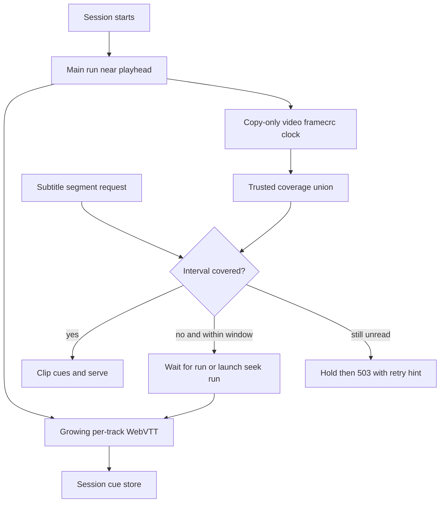

# Subtitles

Active contributors: VeroxAUS

Text subtitles become progressive WebVTT renditions; bitmap subtitles are burned into encoded video. When the client omits a subtitle choice, the server chooses an English default based on the selected audio (`apps/server/src/playback/defaultSubtitle.ts`, `apps/server/src/playback/subtitleExtractor.ts`).

## Layout and key abstractions

| Module                                          | Responsibility                                       |
| ----------------------------------------------- | ---------------------------------------------------- |
| `apps/server/src/playback/defaultSubtitle.ts`   | Automatic default, separate from explicit validation |
| `apps/server/src/playback/tracks.ts`            | Sidecar/burn validity and video restart plan         |
| `apps/server/src/playback/subtitleExtractor.ts` | Bounded main/seek run scheduling and holds           |
| `apps/server/src/playback/subtitleRun.ts`       | One FFmpeg, growing track readers and coverage clock |
| `apps/server/src/playback/subtitleStore.ts`     | Session-owned deduplicated cues and trusted coverage |
| `apps/server/src/playback/extractorSchedule.ts` | Heavy-source concurrency and bandwidth pacing policy |
| `apps/server/src/playback/vtt.ts`               | Cue parsing, clipping and timestamp rendering        |

Probe recognizes SubRip/SRT, ASS/SSA, mov_text, WebVTT and text as text; PGS, DVD, DVB and XSUB as bitmap. Other subtitle codecs are omitted. At most **10 text tracks** get renditions: prefer English when over the cap, force the selected text track to remain, then keep source order. Bitmap tracks remain listed with a null text URL (`apps/server/src/playback/probe.ts`, `apps/server/src/playback/subtitleExtractor.ts`, `apps/server/src/playback/session.ts`).

## Automatic selection

Only an **omitted** start-request `subtitle` triggers defaults. `subtitle: null` means explicit Off; a supplied selection is validated as-is. The starting audio track is selected first, so the subtitle rule follows that track, not just the title's original language (`apps/server/src/playback/manager.ts`).

| Starting audio        | Automatic choice                                                                   |
| --------------------- | ---------------------------------------------------------------------------------- |
| English               | Forced English track; otherwise Off                                                |
| Known non-English     | Full English track; if absent, forced English; otherwise Off                       |
| Undetermined/no audio | Use TMDB original language for the same rule; Off if neither identifies a language |

Forced means disposition or a title containing “forced”. English default matching accepts `en`, `eng`, `english` and suffixed language variants. Within the relevant full/forced pool, text wins over bitmap; within a kind the order is default non-SDH, any default, non-SDH, then file order. A full bitmap can therefore beat forced text for non-English audio (`apps/server/src/playback/defaultSubtitle.ts`).

A bitmap default enables burn-in automatically. Text defaults are the sole rendition with `DEFAULT=YES,AUTOSELECT=YES`; `FORCED=YES` is set when applicable. Explicit text choices remain in `selectedSubtitle` without those automatic-default flags. Responses/activity expose `subtitleDefault` as `forced-english`, `english` or null (`apps/server/src/playback/playlist.ts`, `apps/server/src/playback/session.ts`).

Any explicit subtitle PATCH, including Off, clears automatic-default provenance. An audio-only PATCH preserves the previous subtitle/default; it does not rerun the heuristic. This avoids silently re-enabling captions after a user turned them off (`apps/server/src/playback/manager.ts`, `apps/server/test/integration/default-subtitles-routes.test.ts`).

## Progressive text extraction



The main run starts alongside video at `max(0, floor(requestedStartSec−40))`. It reads the source once for all rendered text tracks and writes a copy-only video `framecrc` output as its clock. Sparse forced/signs tracks cannot reliably drive FFmpeg's ordinary progress clock; `-copyts` retains absolute source times (`apps/server/src/playback/subtitleRun.ts`).

Runs tail outputs every **250 ms**, preserving UTF-8 decoder state and incomplete cue blocks. A newline-terminated newest cue can be accepted before the next blank separator. Coverage advances only after track files have been read against a sampled video head (`apps/server/src/playback/subtitleRun.ts`, `apps/server/src/playback/vtt.ts`).

### Coverage is not cue presence

- A zero-start run trusts coverage from zero; nonzero seeks trust from **ss+10 seconds**, protecting against cues that began before the seek.
- Live trusted coverage ends **6 seconds behind committed video head** for container/read lag.
- Clean completion covers from that run's trusted start through infinity. It does not fill a missing prefix.
- The store unions coverage over runs; complete means no gap before duration minus **0.5 seconds**. An empty covered segment is genuine silence, not unread data (`apps/server/src/playback/subtitleRun.ts`, `apps/server/src/playback/subtitleStore.ts`).

Cues are deduplicated by start/end/text, sorted deterministically and retain settings. Four-second segments clip overlapping cues while retaining **absolute** times and `X-TIMESTAMP-MAP=MPEGTS:0,LOCAL:00:00:00.000`; full VTT keeps original cue times without that map (`apps/server/src/playback/subtitleStore.ts`, `apps/server/src/playback/vtt.ts`).

### Scheduling and read-ahead

A relevant, unheld run within **120 seconds** of the requested position is waited for. Otherwise a seek run starts 40 seconds before the target. Light sources permit **2** extractor processes; heavy sources permit **1**, replacing the old run only after it stops. A non-main run is replaced preferentially. Earlier overlapping runs stop after reading ten seconds into a later run's trusted territory (`apps/server/src/playback/subtitleExtractor.ts`, `apps/server/src/playback/extractorSchedule.ts`).

There is **no automatic prefix/head-fill scan** after a late start. Earlier gaps are extracted when requested. Long titles also stop extraction at the read-ahead window, so `fullUrl` need not appear early or at all during ordinary partial viewing.

Each run has its own hold window measured from `max(playerReach, run.ss)`, using default **180-second hold / below-120-second resume**. Player reach is the greater of reported position and last requested video-segment start. An unread subtitle request beyond player reach plus the window does not launch far-ahead work; it continues returning not-ready until the player is closer (`apps/server/src/playback/subtitleExtractor.ts`, `apps/server/src/playback/manager.ts`). See [network controls](../network.md).

## Bandwidth scheduling

“Heavy” means source height **≥2160** or estimated average bitrate **≥45,000,000 bit/s** from source size/duration. This is source workload, not output dimensions (`apps/server/src/playback/extractorSchedule.ts`).

| Situation                      | Upstream extractor pacing                                                                   |
| ------------------------------ | ------------------------------------------------------------------------------------------- |
| Video finished                 | No local extractor pacing                                                                   |
| Heavy source, encoder not warm | **6 MiB/s**, including initial burst                                                        |
| Fresh main/seek burst          | Unlimited unless positive average video speed <1.35×, then **2 MiB/s**                      |
| Outside burst                  | **2 MiB/s** if lead <30 seconds or positive recent/average speed <1.6×; otherwise unlimited |

### Heavy-source warm-up and the burst clock

`encoderWarm()` in `apps/server/src/playback/extractorSchedule.ts` checks progress relative to the **current video run's start**. It is warm when video is done, when `headSegment − startSegment ≥10`, or when that difference is at least **3** and `(recentSpeed || averageSpeed) ≥2×`. These are progress/speed conditions, not a fixed warm-up timer. Recent speed comes from a roughly four-second sample window with at least 1.5 seconds of span (`apps/server/src/playback/manager.ts`).

The manager calls `SubtitleExtractor.noteEncoderWarm()` in `apps/server/src/playback/subtitleExtractor.ts` when a heavy source meets that condition. Each running extractor gets its first warm timestamp only once. `burstActive()` then uses:

```text
nowMs − max(extractorStartedAtMs, warmAtMs ?? 0) < 25,000
and extractorHeadSec < needSec
```

Fresh main/seek runs set `needSec` to the requested position plus **72 seconds**. Light sources have no warm timestamp, so their clock begins at extractor launch. A heavy source's burst clock begins when the encoder warms, even if the extractor has already spent most of 25 seconds reading at the 6 MiB/s warm-up rate. Reaching the needed stretch still ends the burst immediately.

This is the fix in HEAD **`7eb94ba`**: counting from extractor launch could exhaust the entire burst before heavy-source warm-up ended. `apps/server/test/playback/extractorSchedule.test.ts` explicitly tests the delayed warm timestamp, the strict 25-second boundary, the target-head boundary and a warm timestamp older than the new run. It is a timer-policy regression, not a claim that all heavy sources warm in a particular number of seconds.

After a video restart, warm-up can apply again relative to the new video start. An existing extractor does not have its first warm timestamp reset. A newly launched seek worker gets its own timestamp. During a burst the **average** encoder speed below 1.35× selects 2 MiB/s; outside the burst the preferred recent/average speed below 1.6× or less than 30 seconds of segment lead selects 2 MiB/s. Unknown zero speed alone does not trigger either speed threshold.

The pacer is per upstream extractor response; it does not promise an aggregate 2/6 MiB/s ceiling across concurrent reads. Cached reads bypass that pacing. **Both encoders and extractors populate/reuse rolling blocks**. All actual proxy media downloads still share the global cap, whose priority order is encoder, prefetch, extractor with aging (`apps/server/src/sourceproxy/serve.ts`, `apps/server/src/sourceproxy/pacer.ts`). “Unlimited” here never bypasses the [global gate](../network.md).

## Readiness and errors

Master/rendition manifests are duration-derived and do not wait for extraction (`apps/server/src/playback/playlist.ts`).

| Condition                                         | Response from `apps/server/src/playback/manager.ts`                                                      |
| ------------------------------------------------- | -------------------------------------------------------------------------------------------------------- |
| Whole requested interval covered                  | 200 WebVTT, possibly legitimately empty                                                                  |
| Interval unread                                   | Poll for up to **6 seconds**, then 503 `subtitle_not_ready`, `Retry-After: 1`, `Cache-Control: no-store` |
| Extraction permanently failed, interval unread    | Header-only WebVTT with `X-Subtitle-Status: failed`                                                      |
| Full track incomplete                             | 404 `subtitle_not_ready`; `fullUrl` stays null                                                           |
| Track without a rendition or out-of-range segment | 404                                                                                                      |

A failed run retries once from 40 seconds before committed head. A second failure marks unfinished extraction error, logs a warning and stops active runs; already-covered intervals remain usable. Ordinary extraction failure does not fail video, but an **RSS watchdog hit does fail the whole session**. See [lifecycle](lifecycle.md).

## Bitmap burn-in and track changes

Bitmap sidecar and text burn modes are rejected. Burn-in maps the selected bitmap stream, uses its authoring canvas when available, scales/tone-maps video first and overlays the subtitles. Subtitle input is resampled to video frame rate **before scaling**, preventing FFmpeg's per-packet subtitle heartbeat from queueing redundant large canvases on high-packet-rate audio (`apps/server/src/playback/tracks.ts`, `apps/server/src/playback/ffmpegArgs.ts`).

Retained HDR overlays use 10-bit YUV and RGB white multiplication **0.58** for SDR reference white. Compatible retained-HDR output width ≥3840 uses NVDEC/CUDA scale plus download, rendering subtitles at 1920×1080 before neighbor upscaling. Other burn paths use software-accessible frames as needed; encoding remains NVENC. Input preroll is up to **10 seconds** with output trimming to the requested segment (`apps/server/src/playback/ffmpegArgs.ts`).

Changing audio or bitmap burn target restarts video and invalidates its old segments/init. Text-only selection does not. The text controller/store survives these video restarts. See [encoding](encoding.md) and [lifecycle](lifecycle.md).

## Modification and test pointers

Change default policy independently of explicit validation. Preserve the unread-versus-silent distinction, held-run handling and selected-track retention when changing extraction. API shape changes must follow [shared contracts](../../packages/shared.md) and [API guidance](../../api/index.md).

Playback-wide footprint at `7eb94ba`: **27 source `.ts` files** under `apps/server/src/playback`, **24 `*.test.ts` files** under `apps/server/test/playback` and `apps/server/test/encode`, and **4 non-test TypeScript helpers** in those test directories. Test/code file ratio is **24/27 = 0.89**; scoped default-branch history has **1 unique human committer**, VeroxAUS, excluding bots. Integration tests elsewhere are excluded. These are overlapping subsystem counts, not subtitle-only coverage. Tests were read, not run. Offline default/scheduling/cue tests and GPU progressive/track tests cover different layers.

## Key source files

| Repository-root path                                            | Role                                                 |
| --------------------------------------------------------------- | ---------------------------------------------------- |
| `apps/server/src/playback/defaultSubtitle.ts`                   | Automatic choice rules                               |
| `apps/server/src/playback/subtitleExtractor.ts`                 | Main/seek scheduling and per-run holds               |
| `apps/server/src/playback/subtitleRun.ts`                       | Progressive reads and trusted coverage clock         |
| `apps/server/src/playback/subtitleStore.ts`                     | Stable cue/coverage union                            |
| `apps/server/src/playback/extractorSchedule.ts`                 | Heavy-source and starvation rules                    |
| `apps/server/src/playback/ffmpegArgs.ts`                        | Bitmap overlay, frame rate and preroll               |
| `apps/server/src/playback/manager.ts`                           | Readiness responses and PATCH integration            |
| `apps/server/test/integration/default-subtitles-routes.test.ts` | Omitted/null/explicit choices and master defaults    |
| `apps/server/test/playback/extractorSchedule.test.ts`           | Warmup, burst and concurrency policy                 |
| `apps/server/test/playback/subtitles.test.ts`                   | Cue, interval, rendition and extraction arguments    |
| `apps/server/test/encode/progressive-subtitles.test.ts`         | Progressive readiness and on-demand earlier coverage |
