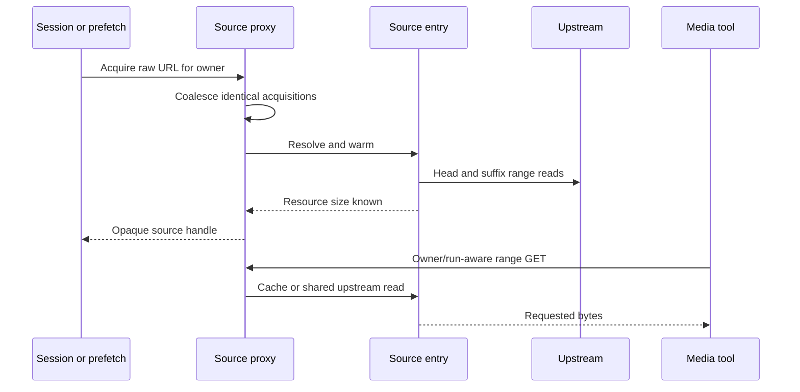

# Source proxy

Active contributors: VeroxAUS

`SourceProxy` in `apps/server/src/sourceproxy/proxy.ts` gives media tools opaque loopback handles while sharing remote bytes and probe results. `SourceEntry` in `apps/server/src/sourceproxy/sourceEntry.ts` owns one exact raw gateway URL's current location and cached data.

## Purpose

Reuse [prefetch](../features/prefetch.md) work across sessions/restarts, hide expiring upstream URLs and enforce reader ownership without coupling viewers' playheads. This is an in-memory ranged cache, not a complete local media download.

## Acquisition and lifetime

The private listener binds **127.0.0.1**. An occupied configured port falls back to a free port. Main and extractor keys are random; owned requests carry another opaque token, and extractor requests include a run ID. Public clients receive HLS, not these handles or CDN links.

A new remote entry starts warming up to **16 MiB head / 8 MiB tail** in parallel. Acquisition completes when size is known, not when both regions finish. Head readiness settles on fill success or failure; partial valid bytes remain usable. A successful/in-flight ffprobe result is shared; a failed probe clears for retry.

Owner references form a set, not independent counted leases for repeated acquisitions with the same owner. Release is idempotent; dropping the final reference drops the entry/cache. Prefetch-only retention defaults to **three entries**, a **ten-minute idle TTL**, and a **30-second sweep**. Session references protect a playing entry from prefetch-only trimming.

## Range serving and shared cache

`BlockCache` in `apps/server/src/sourceproxy/blockCache.ts` stores complete aligned **1 MiB blocks**, default **512 MiB global / 384 MiB per source**. Pinned head/tail, in-flight buffers and process memory sit outside those rolling budgets. Eviction prefers blocks ending at least **96 MiB behind estimated playhead**, otherwise LRU. Position/duration estimates byte playhead; this is not a container seek index.

`serveSource` in `apps/server/src/sourceproxy/serve.ts` checks filled pinned regions, then rolling blocks, then upstream. **Both video and extractor demand reads populate the same cache.** Registered upstream fronts let a follower wait up to **1.5 seconds**, polling every **20 ms**, for bytes within **8 MiB** of another front or its in-progress block.

This reduces duplication, not a mathematical one-fetch-per-byte guarantee. Partial blocks, eviction, an unbound extractor finishing before an encoder arrives, or share timeouts can refetch data.

| Range behavior                    | Result                                        |
| --------------------------------- | --------------------------------------------- |
| Single explicit/open/suffix range | 206 with resource-relative headers            |
| Unsatisfiable range               | 416 and total-size header                     |
| Malformed/multiple ranges         | Fall back to whole resource                   |
| HEAD                              | Headers only                                  |
| Plain file source                 | Local file stream, bypass remote cache/gating |

Demand reads validate the upstream range start, obey downstream backpressure, avoid already-cached blocks and resume interrupted bodies from delivered position. After three zero-progress stalls the response fails. Once headers are sent, transport failure tears down the response rather than replacing it with a JSON error.

## Three independent reader controls

| Control        | Scope and effect                                                                                                                          |
| -------------- | ----------------------------------------------------------------------------------------------------------------------------------------- |
| Time holds     | `ReaderHolds` in `apps/server/src/sourceproxy/readerHolds.ts` keeps each owner's main window and extractor-run holds separate             |
| Byte-gap holds | `ExtractorLeadBound` in `apps/server/src/sourceproxy/leadBound.ts` keeps an owned run near that owner's most recently advanced main front |
| Discard cuts   | `InputCuts` in `apps/server/src/sourceproxy/inputCuts.ts` tears down one owner's main responses and refuses reconnects                    |

Run IDs in different owners do not collide. Unowned probe/plain extractor requests are not time-held. Byte-gap hold begins **strictly beyond half the effective per-source budget**, default 192 MiB, and releases at/below half that distance, default 96 MiB. Effective budget is the smaller global/per-source cap. Without a main reader there is no byte-gap hold.

Remote holds apply before cache delivery too. Upstream stretches end at block boundaries so complete cached blocks survive; the loopback reader stays connected while held. A discard cut is intentionally different: it destroys responses and returns 503 to reconnects until the next launch reset. Other owners and extractor reads remain unaffected. See [playback lifecycle](playback/lifecycle.md).

## Pacing and link recovery

Warm/demand remote media reads share one [download gate](network.md). `RatePacer` in `apps/server/src/sourceproxy/pacer.ts` spreads finite extractor reads over time; the proxy raises finite proposals to at least the gate's 20% extractor share. Cached reads bypass pacing, not holds. URL-resolution probes and upstream metadata clients are separate from media-body scheduling.

`UpstreamClient` in `apps/server/src/sourceproxy/upstream.ts` uses keep-alive ranged HTTP(S), a 30-second socket-idle timeout and placeholder-aware redirects. Expiry statuses 401/403/404/410 trigger refresh. `SourceEntry.open` in `apps/server/src/sourceproxy/sourceEntry.ts` permits at most four attempts, retries transient network/429+ failures, and coalesces refresh by generation. Cached/probed content survives refresh under the assumption that the raw link still identifies the same resource.

Refresh failures produce a URL-free operational event at most once per 30 seconds across the proxy. They do not expose the secret target in an error.

## Modification entry points

Change handles/retention in `apps/server/src/sourceproxy/proxy.ts`, range pumping in `apps/server/src/sourceproxy/serve.ts`, budgets/eviction in `apps/server/src/sourceproxy/blockCache.ts`, and independent holds in their focused modules. Preserve owner separation, checked input cuts and [network](network.md) accounting.

## Key source files

| File                                                   | Purpose                                               |
| ------------------------------------------------------ | ----------------------------------------------------- |
| `apps/server/src/sourceproxy/proxy.ts`                 | Listener, acquisition, handles and retention          |
| `apps/server/src/sourceproxy/sourceEntry.ts`           | Warming, fronts and refresh                           |
| `apps/server/src/sourceproxy/serve.ts`                 | Range pump and shared delivery                        |
| `apps/server/src/sourceproxy/blockCache.ts`            | Complete-block budgets and eviction                   |
| `apps/server/src/sourceproxy/readerHolds.ts`           | Per-owner/run time holds                              |
| `apps/server/src/sourceproxy/leadBound.ts`             | Cache-sized extractor lead                            |
| `apps/server/src/sourceproxy/inputCuts.ts`             | Discarded encoder input                               |
| `apps/server/test/sourceproxy/sessionSharing.test.ts`  | Follower reuse and capacity-limited refetch           |
| `apps/server/test/sourceproxy/leadBound.test.ts`       | Strict hold threshold, hysteresis and owner isolation |
| `apps/server/test/sourceproxy/encoderInputCut.test.ts` | Cut/reconnect behavior                                |

## Measured scope

At **`0a8f04f`**, scoped `git ls-tree` counts **9 `.ts` source / 12 `*.test.ts` files** under the matching sourceproxy source/test directories: **1.33 test files/source file**. Helpers and integration elsewhere are excluded. CODEOWNERS and supplied default-branch history identify **1 unique human**, excluding bots, not an ownership guarantee. Tests were read; no network measurements or encoders were launched.
