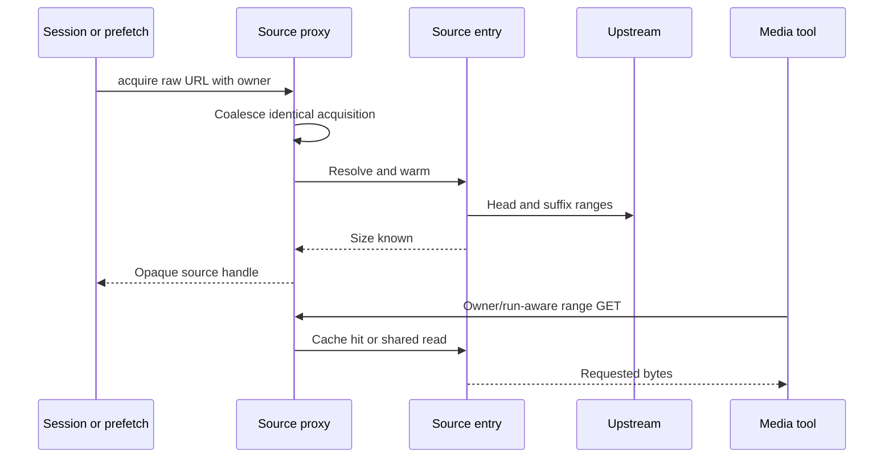

# Source proxy

Active contributors: VeroxAUS

## Purpose

The loopback proxy hides expiring upstream URLs and shares ranged bytes/probes between prefetch, encoders and subtitle workers. `SourceProxy` in `apps/server/src/sourceproxy/proxy.ts` owns source handles; `SourceEntry` in `apps/server/src/sourceproxy/sourceEntry.ts` owns one exact raw gateway URL's resolved location and cached data.

## Layout and acquire flow

The listener binds **127.0.0.1**; occupied configured ports fall back to a free port. Main/extractor keys are opaque. Owner references are a set, not independent counted leases for repeated acquisition with the same owner (`apps/server/src/sourceproxy/proxy.ts`).

A new entry resolves once and starts up to **16 MiB head / 8 MiB tail** warming. Acquisition completes when size is known; head readiness settles on fill completion or failure, not guaranteed full fill. Probe success/in-flight work is shared; failed probes clear for retry.

Prefetch-only retention defaults to **three sources**, **ten-minute idle TTL** and a **30-second sweep**. Session ownership prevents prefetch-only eviction of a playing source.

## Shared cache and ranged serving

`BlockCache` in `apps/server/src/sourceproxy/blockCache.ts` stores complete aligned **1 MiB** blocks, default **512 MiB global / 384 MiB per-source** rolling budgets. Pinned head/tail and in-flight buffers are outside those budgets. Eviction prefers sufficiently behind-playhead blocks, then LRU. Playhead byte location is an estimate from position/duration, not a container index.

`serveSource` in `apps/server/src/sourceproxy/serve.ts` checks filled pinned regions, rolling blocks and then upstream. **Both encoder and extractor reads populate the same cache.** A trailing reader waits up to **1.5 seconds**, polling every 20 ms, when another front is within 8 MiB or completing its block. Fronts are registered before dispatch so interleaved arrivals can join. This reduces duplicate work but does not promise exactly one fetch per byte: partial blocks, eviction and timeout can still refetch.

Single explicit/open/suffix ranges are supported. Unsatisfiable requests return 416; malformed/multiple ranges fall back to whole-resource behavior. HEAD sends headers only. Local files bypass remote cache/gating. Demand reads validate upstream range starts, preserve downstream backpressure and resume interrupted bodies from their last delivered position (`apps/server/src/sourceproxy/serve.ts`).

## Per-owner holds and byte lead bound

`ReaderHolds` in `apps/server/src/sourceproxy/readerHolds.ts` assigns an opaque owner token to main/run URLs. Each session holds its own main reader and extractor runs, even when source bytes are shared. Identical run IDs in different sessions do not collide. Unowned probe/plain extractor reads are not time-held.

`ExtractorLeadBound` in `apps/server/src/sourceproxy/leadBound.ts` keeps an owned extractor near that session's most recently advanced main-reader front. Hold distance is **half the per-source rolling budget**, default **192 MiB**; release is at half that distance, default **96 MiB**. No main reader means no byte-gap hold. This is independent of the player's time window.

Remote pumps apply holds before cache delivery too. Active upstream reads stop on block boundaries when held, retaining complete blocks; the loopback consumer remains connected while waiting (`apps/server/src/sourceproxy/serve.ts`).

`InputCuts` in `apps/server/src/sourceproxy/inputCuts.ts` is different: it destroys one owner's encoder responses and rejects reconnects with 503 while an old encoder is discarded. Launch reset reopens that token. Other owners and extractor reads are unaffected.

## Pacing and recovery

All actual remote media bytes, including warming, pass through one [download gate](network.md). Finite local extractor pacing is raised to at least the gate's 20% share; cached reads bypass pacing. Playback supplies policy hints, while the proxy enforces holds and actual bytes (`apps/server/src/sourceproxy/proxy.ts`, `apps/server/src/sourceproxy/pacer.ts`).

`UpstreamClient` in `apps/server/src/sourceproxy/upstream.ts` performs ranged transport and rejects placeholder redirect targets. `apps/server/src/sourceproxy/sourceEntry.ts` refreshes expired links and retries transient failures, sharing refresh by generation. Refresh retains cached/probed content under the assumption that the raw link still identifies the same resource.

## Modification entry points

Change ownership/URLs in `apps/server/src/sourceproxy/proxy.ts`, range pumping in `apps/server/src/sourceproxy/serve.ts`, cache rules in `apps/server/src/sourceproxy/blockCache.ts`, and independent hold policies in their dedicated modules. Preserve the checked stop contract used by [playback lifecycle](playback/lifecycle.md).

## Key source files

| File | Purpose |
| --- | --- |
| `apps/server/src/sourceproxy/proxy.ts` | Handles, retention and listener |
| `apps/server/src/sourceproxy/sourceEntry.ts` | Warm/refresh/front state |
| `apps/server/src/sourceproxy/serve.ts` | Range pump and cache sharing |
| `apps/server/src/sourceproxy/blockCache.ts` | Rolling budgets |
| `apps/server/src/sourceproxy/readerHolds.ts` | Owner/run time holds |
| `apps/server/src/sourceproxy/leadBound.ts` | Cache-sized extractor lead |
| `apps/server/src/sourceproxy/inputCuts.ts` | Discarded encoder input |

## Measured scope

At `5eefa37`, scoped `git ls-files` counts **9 source `.ts` / 12 matching `*.test.ts` files**, ratio **1.33** under sourceproxy source/test directories. Helpers and integration elsewhere are excluded. Default-branch history/CODEOWNERS identify **1 unique human author**, excluding bots. No network/encoder tests were executed.
