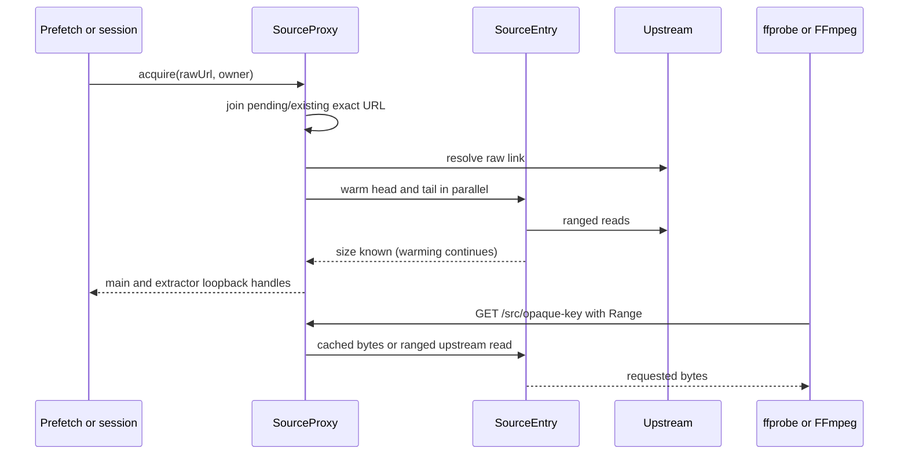

# Source proxy

Active contributors: VeroxAUS (origin/main sole human)

The source proxy is an internal loopback HTTP server that shields FFmpeg/ffprobe from expiring upstream URLs and shares source bytes and successful probe results across prefetches, sessions, and encoder restarts. It is separate from the public Fastify HLS API.

## Layout and key abstractions

| Module | Responsibility |
| --- | --- |
| `apps/server/src/sourceproxy/proxy.ts` | Listener, acquisition deduplication, handles, keys, owners, prefetch expiry |
| `apps/server/src/sourceproxy/sourceEntry.ts` | Current resolved link, size, pinned head/tail, refresh generation, playback hints |
| `apps/server/src/sourceproxy/serve.ts` | HTTP ranges, memory/local/upstream pumping, extractor throttle |
| `apps/server/src/sourceproxy/blockCache.ts` | Shared bounded rolling block cache |
| `apps/server/src/sourceproxy/upstream.ts` | Keep-alive ranged HTTP client and typed failures |

`SourceEntry` is keyed by the **exact raw source URL**, not content hash or final CDN URL. Its `refs` is a set of owner strings (session UUID or `prefetch`), not a per-handle reference counter. `SourceHandle.release()` is idempotent, but callers must not treat repeated acquisitions under the same owner string as independently counted leases.

## Acquire-to-read flow

Listener binding is **127.0.0.1 only**, lazily started once; port zero chooses a free port. If a requested nonzero port is occupied, it logs a warning and falls back to an ephemeral port. Main and extractor keys each use 12 random bytes encoded base64url. Only GET/HEAD are allowed; unknown paths/keys return 404, writes 405.

New acquisitions coalesce in a pending map so simultaneous prefetch/playback uses one source creation. The resolver follows the gateway link with a one-byte ranged GET; acquisition then resolves as soon as warm-up learns total size, not when all warm bytes arrive.

`probe()` memoizes one successful/in-flight probe promise through the main loopback URL. A rejected probe clears that promise so a later attempt can retry. “Once” means once successfully per retained entry, not forever across eviction or failures.

## Shared ownership and lifetime

All owners share opaque main/extractor URLs, probe, buffers, rolling blocks, refresh state, and **one playhead byte estimate and starved flag**. Playback hints are entry-level last-writer values, not per-session aggregates; concurrent viewers of the same raw URL do not get independently coordinated cache-priority/throttle decisions.

Releasing the last distinct owner drops map/key entries, rolling blocks, and pinned regions; old URLs then return 404. An active session keeps an entry alive even after a prefetch lease expires. [Prefetch](../features/prefetch.md) owns its scheduling policy; proxy retention defaults are:

- At most **3 prefetch-only entries**, dropping oldest-used entries when acquiring another.
- A **10-minute idle TTL** for the `prefetch` owner, checked every **30 seconds**.
- Activity updates last-used time; TTL is not a fixed ten minutes from creation.

Dropping the entry invalidates future key lookups and releases cached regions; it is not described here as an immediate cancellation barrier for every already-open read. `close()` drops entries, destroys upstream agents, closes HTTP connections, and refuses new acquisitions with `shutting_down`.

## Cache layout and memory limits

| Region | Default | Behavior |
| --- | --- | --- |
| Head | Up to **16 MiB** per remote source | Filled progressively from byte zero |
| Tail | Up to **8 MiB** per remote source | Suffix request; useful for container indexes |
| Rolling cache | **1 MiB** complete aligned blocks | Populated by main-consumer upstream reads only |
| Global rolling cap | **1.5 GiB** | Across all sources |
| Per-source rolling cap | **768 MiB** | Prevents one source consuming the whole rolling cache |
| Behind-playhead preference | **96 MiB** | Prefer eviction of blocks ending this far behind the estimated player byte position |

The rolling cap **does not include pinned head/tail buffers**, in-flight responses, cue stores, or other process memory. Head and tail may overlap on small sources. Cache statistics expose rolling bytes/blocks/evictions, not total RSS.

Serving first uses valid filled head/tail bytes, then rolling blocks, then upstream. Requests can consume the beginning of a region before the rest fills. Partial warm data survives download failure; missing remainder can be fetched on demand. Without suffix-range support, tail warming is abandoned and later reads fetch on demand.

The rolling cache uses global recency order: evict the least-recent candidate sufficiently behind its source playhead, otherwise ordinary LRU. Per-source enforcement restricts victims to that source. Playhead fraction is clamped to [0,1] and multiplied by file size—an approximation, not a time-to-byte index.

Only whole aligned blocks are retained; a read beginning mid-block skips collection until the next boundary, and trailing partial blocks are not cached. Upstream reads stop before cached blocks or tail and scan at most 1,024 block indexes ahead. Repeated completed reads can reuse bytes; there is no in-flight miss coalescer guaranteeing concurrent readers never download the same range.

## Range transport, priority, and recovery

Single explicit, open-ended, and suffix ranges receive 206 with Content-Range; ordinary GET gets 200. Unsatisfiable starts/zero suffixes receive 416. Malformed/multi-range headers fall back to the whole resource rather than multipart support. HEAD returns headers without a body. Local resolved file paths use the same loopback/range contract but stream directly from disk, without remote caching.

Remote on-demand reads require the upstream to honor the requested start. A server that only returns whole-body 200 can warm the head/learn size but cannot satisfy arbitrary nonzero seeks. Backpressure is respected; disconnecting the loopback reader aborts its upstream request. Once headers are sent, a failure destroys the response rather than attempting a new JSON error body.

The keep-alive client permits 32 sockets per HTTP/HTTPS agent, a **30-second socket idle timeout**, and up to **3 redirects**. Opening a range allows **4 attempts**:

- 401/403/404/410 trigger one fresh gateway resolution.
- Network failures or status ≥429 are transient; delays increase by 250 ms per attempt, with refresh after repeated trouble.
- Generation checks and a shared refresh promise coalesce readers failing on the same expired link.
- A body that fails after delivering bytes resumes from its last position. Three consecutive no-progress reads fail the pump.

Refreshing changes the upstream link but preserves existing cache/probe state, assuming the raw URL still identifies the same resource. Explicit video recovery can also request refresh; see [playback lifecycle](playback/lifecycle.md).

Extractors read existing memory but do not populate rolling blocks. Their **upstream** reads slow to **2 MiB/s** while the shared source is encoder-starved; main reads and memory reads are exempt. This limits a full subtitle scan from displacing playback's useful cache. Playback supplies starvation hints based on lead/speed and temporary initial bursts; see [subtitles](playback/subtitles.md).

## Integrations and modification entry points

The [playback manager](playback/index.md) and [prefetch service](../features/prefetch.md) acquire/release handles; ffprobe, video FFmpeg, and subtitle FFmpeg read those URLs. Raw/CDN locations are kept off their command lines; typed upstream errors omit URLs, and refresh logs contain no raw link.

Change lifetime/owner semantics in `apps/server/src/sourceproxy/proxy.ts`; warm-up/retry policy in `apps/server/src/sourceproxy/sourceEntry.ts`; read boundaries and throttle in `apps/server/src/sourceproxy/serve.ts`; memory budget/eviction in `apps/server/src/sourceproxy/blockCache.ts`. Do not bypass the handle by independently resolving CDN URLs in an encoder. See [security](../security.md) for the public/internal trust boundaries rather than interpreting opaque keys as general user authentication.

## Measured scope and test evidence

Recursive working-tree enumeration finds **5 source `.ts` files**, **2 `*.test.ts` files**, and **1 helper `.ts` file** in `apps/server/src/sourceproxy` and `apps/server/test/sourceproxy`. Scope excludes playback resolver/probe, callers, and routes. Scoped `git log origin/main --format="%cn <%ce>" -- apps/server/src/sourceproxy apps/server/test/sourceproxy` has **1 unique committer**, VeroxAUS.

Read tests assert progressive warm reads, byte-exact ranges, cache reuse, extractor nonpollution/throttle, disconnect aborts, refresh after expiry, transient 503 retry, shared probe/owners, TTL/entry limit, local files, and cache eviction preferences. Tests were **not executed** for this documentation, and counters are not a claim of an external metrics backend. `upstreamRequests`/`upstreamBytes` count demand-pump activity, not every resolver or background warm request.

## Key source files

| Repository-root path | Role |
| --- | --- |
| `apps/server/src/sourceproxy/proxy.ts` | Handles, owners, listener, and retention |
| `apps/server/src/sourceproxy/sourceEntry.ts` | Warm regions and link refresh |
| `apps/server/src/sourceproxy/serve.ts` | Range response and byte pump |
| `apps/server/src/sourceproxy/blockCache.ts` | LRU and playhead-aware memory policy |
| `apps/server/src/sourceproxy/upstream.ts` | Ranged transport and failure types |
| `apps/server/src/playback/resolveUrl.ts` | Initial gateway-to-CDN resolution |
| `apps/server/test/sourceproxy/proxy.test.ts` | Proxy behavior expectations |
| `apps/server/test/sourceproxy/blockCache.test.ts` | Cache limit and eviction expectations |
