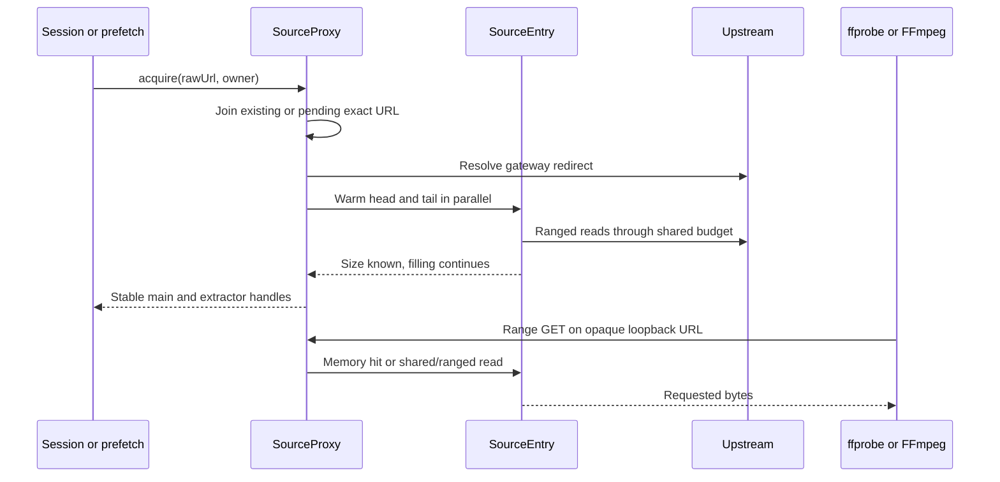

# Source proxy

Active contributors: VeroxAUS

The source proxy hides expiring upstream media links behind stable loopback URLs and shares source bytes and successful probes across prefetch, sessions and encoder restarts. It is a separate HTTP server from the public Fastify HLS routes (`apps/server/src/sourceproxy/proxy.ts`).

## Layout and key abstractions

| Module                                       | Responsibility                                                         |
| -------------------------------------------- | ---------------------------------------------------------------------- |
| `apps/server/src/sourceproxy/proxy.ts`       | Listener, acquire coalescing, opaque keys, owners and prefetch expiry  |
| `apps/server/src/sourceproxy/sourceEntry.ts` | Resolved link, warm regions, refresh, reader fronts and playback hints |
| `apps/server/src/sourceproxy/serve.ts`       | Range responses, memory/local/upstream pumping and sharing waits       |
| `apps/server/src/sourceproxy/blockCache.ts`  | Shared rolling blocks and playhead-aware LRU                           |
| `apps/server/src/sourceproxy/pacer.ts`       | Per-response subtitle pacing                                           |
| `apps/server/src/sourceproxy/upstream.ts`    | Keep-alive ranged HTTP transport and typed failures                    |

A `SourceEntry` in `apps/server/src/sourceproxy/sourceEntry.ts` is keyed by the **exact raw gateway URL**, not a content hash or final media URL. `SourceHandle` in `apps/server/src/sourceproxy/proxy.ts` exposes main/extractor URLs, probe, refresh, lead/hold hints and idempotent release. All consumers of an entry share the underlying bytes.

## Acquire-to-read flow

The listener binds **127.0.0.1 only**. Default configuration is public port +50, normally **8650**; port zero chooses a free port. An occupied configured nonzero port falls back to an ephemeral port with a warning. Main/extractor keys each contain 12 random bytes encoded base64url. GET/HEAD are accepted; unknown paths/keys return 404, writes 405 (`apps/server/src/sourceproxy/proxy.ts`, `apps/server/src/config.ts`).

Concurrent acquisitions coalesce in a pending map. Gateway resolution uses a one-byte ranged GET and manually follows redirects, rejecting gateway placeholder clips before downloading them. Acquisition returns once warming knows resource size; it need not wait for the 16 MiB head or 8 MiB tail to finish. `headReady` settles on fill completion **or failure**, not a guarantee that every head byte is present (`apps/server/src/playback/resolveUrl.ts`, `apps/server/src/sourceproxy/sourceEntry.ts`).

`probe()` shares one in-flight/successful ffprobe promise on the main loopback URL. Failure clears it, allowing a later attempt. A retained [prefetch](../features/prefetch.md) can therefore remove resolution/probe work from [playback startup](playback/index.md) (`apps/server/src/sourceproxy/proxy.ts`).

## Ownership and lifetime

Owner references are a **set of strings**: normally a session UUID or `prefetch`. Repeated acquisitions with the same owner are not independent counted leases. Releasing the last owner drops key/map entries, rolling blocks and pinned regions; future reads of those URLs return 404 (`apps/server/src/sourceproxy/proxy.ts`).

Prefetch-only retention defaults to **3 entries**, with oldest-used entries dropped when necessary. The `prefetch` owner expires after **10 minutes idle**, checked every **30 seconds**. A live session owner keeps the entry after prefetch expiry. Closing refuses new acquisitions, releases the download gate, drops sources, destroys upstream agents and closes HTTP connections.

Shared state needs care:

- Encoder leads are recorded **per owner**, and the **smallest** lead controls shared encoder priority/read-ahead. One viewer needing data keeps the shared main URL reading (`apps/server/src/sourceproxy/sourceEntry.ts`).
- Cache playhead byte estimate and extractor pacing limit remain **entry-wide last-writer values**. They are not independent per-viewer cache policies (`apps/server/src/sourceproxy/proxy.ts`).
- Extractor holds are keyed by run ID on that entry. Handles do not add a session namespace to run IDs.
- Entry release invalidates future lookup; do not treat it as a universal immediate cancellation barrier for every already-open read.

## Cache layout

| Region                     |                 Default | Behavior                                              |
| -------------------------- | ----------------------: | ----------------------------------------------------- |
| Pinned head                | Up to **16 MiB/source** | Progressive fill from byte zero                       |
| Pinned tail                |  Up to **8 MiB/source** | Suffix read for container indexes                     |
| Rolling block              |               **1 MiB** | Whole aligned blocks from either encoder or extractor |
| Global rolling cap         |             **512 MiB** | Across entries                                        |
| Per-source rolling cap     |             **384 MiB** | Prevent one entry taking the whole pool               |
| Behind-playhead preference |              **96 MiB** | Evict blocks ending at least this far behind first    |

Defaults are in `apps/server/src/sourceproxy/sourceEntry.ts` and `apps/server/src/sourceproxy/blockCache.ts`. Rolling limits exclude pinned regions, in-flight chunks, subtitle cues and the rest of Node's memory; they are not total RSS limits.

Serving checks filled head, filled tail, rolling blocks, then upstream. A partially filled region can serve its current prefix; a warm failure preserves received bytes and demand reads fetch missing remainder. Without suffix-range support, tail warming is abandoned. Local resolved paths stream directly from disk without remote cache or download/read-ahead gating (`apps/server/src/sourceproxy/serve.ts`, `apps/server/src/sourceproxy/sourceEntry.ts`).

The block cache uses global recency order. Evict the least-recent block sufficiently behind its owner's approximate playhead, otherwise ordinary LRU; per-source pressure restricts victims to that source. Playhead is `clamp(position/duration) × fileSize`, not a container time-to-byte index (`apps/server/src/sourceproxy/blockCache.ts`, `apps/server/src/playback/manager.ts`).

Only complete aligned blocks are collected. A mid-block start skips to the next boundary and trailing partial blocks are not retained. Upstream reads stop before cached blocks/tail and scan at most **256** block indexes ahead (`apps/server/src/sourceproxy/serve.ts`).

### Sharing active reads

**Extractors populate the same rolling cache as encoders.** Either reader can pay for a range first; the later one can use memory. A reader can wait for another active upstream front that is within **8 MiB** or is finishing the same block. It polls every **20 ms**, for at most **1.5 seconds**, before fetching for itself (`apps/server/src/sourceproxy/sourceEntry.ts`, `apps/server/src/sourceproxy/serve.ts`).

This is bounded duplicate avoidance, not a guarantee of exactly one request per range: unaligned partials, eviction, distant fronts or a timed-out sharing wait can still cause refetches. Regression tests cover sequential reuse in both directions and a trailing reader (`apps/server/test/sourceproxy/sharing.test.ts`).

## Range transport and recovery

Single explicit, open-ended and suffix ranges produce 206/Content-Range; ordinary GET produces 200. Unsatisfiable starts/zero suffixes give 416. Malformed/multiple ranges fall back to whole-resource behavior rather than multipart output. HEAD sends headers only (`apps/server/src/sourceproxy/serve.ts`).

Remote demand reads require the upstream to honor their start; a whole-body-only upstream can warm byte zero but cannot fulfill arbitrary nonzero seeks. Responses honor downstream backpressure; disconnect aborts upstream. Once headers are sent, errors tear down the response rather than return a second JSON body.

The keep-alive client allows **32 sockets per HTTP/HTTPS agent**, **30-second socket idle timeout**, and up to **3 redirects**. `SourceEntry.open()` permits **4 attempts** (`apps/server/src/sourceproxy/upstream.ts`, `apps/server/src/sourceproxy/sourceEntry.ts`):

- 401/403/404/410 request fresh gateway resolution once.
- Network errors or statuses ≥429 are transient; increasing 250 ms delays and refresh after repeated trouble are used.
- Generation checks plus one shared refresh promise coalesce readers failing on the same expired link.
- A body failure after progress resumes at the next unread byte; three consecutive no-progress demand reads fail the pump.

Refresh changes the location but retains probe/cache state, assuming the raw link still names the same resource. Refresh failures produce a redacted warning/error event at most once per **30 seconds** across the proxy. [Encoder recovery](playback/lifecycle.md) can also request refresh explicitly (`apps/server/src/sourceproxy/proxy.ts`).

## Download and read-ahead integration

Head/tail warming and demand upstream bytes pass through one [global download gate](network.md). Cached and local-file reads do not spend its tokens. The initial gateway redirect resolver itself is outside that media-body gate (`apps/server/src/sourceproxy/sourceEntry.ts`, `apps/server/src/playback/resolveUrl.ts`).

Remote loopback pumps wait at the read-ahead boundary before even serving cached bytes. An upstream response is cut at the hold so buffered network data does not keep streaming; the loopback reader stays connected until released. Extractors use run-specific URLs for independent holds and per-response local pacing. Both remain subject to the aggregate cap; [subtitles](playback/subtitles.md) explains heavy-source/warmup limits.

The proxy does not decide when video is warm or when a fresh subtitle burst begins. The playback manager calculates those conditions and calls `setExtractorLimit()`. At HEAD the warm-up timestamp delays the burst clock, while this byte pump continues to enforce whichever rate it receives. Cached blocks bypass the extractor pacer, but not a run's read-ahead hold (`apps/server/src/playback/manager.ts`, `apps/server/src/playback/extractorSchedule.ts`, `apps/server/src/sourceproxy/serve.ts`).

## Modification and test pointers

Preserve opaque handle ownership rather than resolving CDN URLs inside encoders. Change lifetime in the proxy, warming/refresh/front coordination in the entry, range boundaries in serving and budgets in the block cache. [Security](../security.md) describes the LAN/internal trust boundary; opaque keys are not user authentication.

Measured at `7eb94ba`: **6 source `.ts` / 7 `*.test.ts` / 2 non-test TypeScript helper files**, test/code file ratio **7/6 = 1.17**, under `apps/server/src/sourceproxy` and `apps/server/test/sourceproxy`. This excludes network and playback tests and is not a coverage measurement. Scoped default-branch history has **1 unique human committer, VeroxAUS**, excluding bots. Tests were inspected, not executed.

Counters distinguish served/cache bytes from demand upstream bytes. `upstreamRequests`/`upstreamBytes` omit resolver and warm traffic; the network gate's meter includes warm media bodies. Do not equate rolling-cache statistics with process RSS or sum shared-source per-session rates as independent traffic (`apps/server/src/sourceproxy/proxy.ts`, `apps/server/src/sourceproxy/serve.ts`).

## Key source files

| Repository-root path                                   | Role                                              |
| ------------------------------------------------------ | ------------------------------------------------- |
| `apps/server/src/sourceproxy/proxy.ts`                 | Listener, handles, retention and network snapshot |
| `apps/server/src/sourceproxy/sourceEntry.ts`           | Warm regions, shared leads/fronts and refresh     |
| `apps/server/src/sourceproxy/serve.ts`                 | Range parser and byte pump                        |
| `apps/server/src/sourceproxy/blockCache.ts`            | Global/per-source cache policy                    |
| `apps/server/src/sourceproxy/upstream.ts`              | Typed ranged transport                            |
| `apps/server/src/sourceproxy/pacer.ts`                 | Extractor response pacing                         |
| `apps/server/src/playback/resolveUrl.ts`               | Initial gateway redirect/placeholder resolution   |
| `apps/server/test/sourceproxy/proxy.test.ts`           | Ranges, cache, ownership, expiry and refresh      |
| `apps/server/test/sourceproxy/sharing.test.ts`         | Encoder/extractor reuse and trailing readers      |
| `apps/server/test/sourceproxy/readAheadWindow.test.ts` | Holds and smallest-owner lead behavior            |
