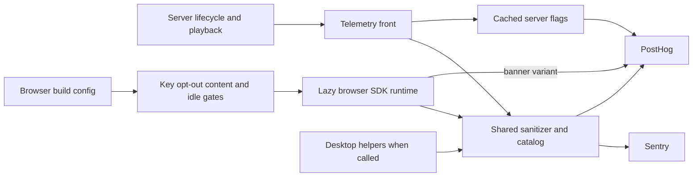

# Telemetry

Active contributors: VeroxAUS

## Purpose

Telemetry is the optional outbound boundary for Sentry reports, PostHog catalog events and feature flags across the server, browser and desktop support modules. Missing keys leave the corresponding client off; local logs, SSE and metrics do not require cloud telemetry (`apps/server/src/telemetry/index.ts`, `apps/web/src/telemetry/index.ts`). `docs/PRIVACY.md` is the maintained disclosure; desktop shell initialization remains planned, not wired.

## Directory layout and abstractions

```text
apps/server/src/telemetry/       # front, clients, flags and playback observer
apps/web/src/telemetry/          # build config, SDK-free facade, lazy runtime
apps/desktop/src/telemetry/      # config, option builder, scrubber and analytics
packages/shared/src/analytics.ts
packages/shared/src/sanitize.ts
packages/shared/src/identity.ts
packages/shared/src/flags.ts
```

| Abstraction                     | Source                                                                     | Role                                                           |
| ------------------------------- | -------------------------------------------------------------------------- | -------------------------------------------------------------- |
| `Telemetry` / `createTelemetry` | `apps/server/src/telemetry/types.ts`, `apps/server/src/telemetry/index.ts` | Safe front with no-op fallback, flags and bounded shutdown     |
| `startTelemetryWhenIdle`        | `apps/web/src/telemetry/index.ts`                                          | Key/opt-out guard and dynamic runtime loading                  |
| `buildMainSentryOptions`        | `apps/desktop/src/telemetry/sentry.ts`                                     | Pure main-process options or `null`, no SDK initialization     |
| `sanitizeSentryEvent`           | `packages/shared/src/sanitize.ts`                                          | Scrubbed Sentry payload and explicit IP/geo-inference controls |
| `sanitizeEventProperties`       | `packages/shared/src/analytics.ts`                                         | Per-event property allowlist and value validation              |
| `FlagService`                   | `apps/server/src/telemetry/flags.ts`                                       | Cached values, cold-read budget and local defaults             |



## Activation and identities

| Runtime          | Activation and defaults                                                                                                                                                                                              |
| ---------------- | -------------------------------------------------------------------------------------------------------------------------------------------------------------------------------------------------------------------- |
| Server           | `SENTRY_DSN_SERVER` and `POSTHOG_API_KEY` independently enable clients; default PostHog host `https://us.i.posthog.com`; environment development unless packaged, `apps/server/src/config.ts`                        |
| Browser/renderer | `SENTRY_DSN_WEB`, `POSTHOG_API_KEY`, `POSTHOG_HOST`, release/environment baked into `HS_TELEMETRY`; default environment production, release `homestream@<web package version>`, `apps/web/src/telemetry/buildEnv.ts` |
| Desktop support  | Caller supplies populated environment and packaged state; uses `SENTRY_DSN_WEB`, default environment development unless packaged, normalized HTTP(S) PostHog origin, `apps/desktop/src/telemetry/config.ts`          |

The master switch recognizes `off`, `0`, `false`, `no` and `disabled`, case-insensitively. Browser and desktop trim the switch before matching (`apps/server/src/config.ts`, `apps/web/src/telemetry/buildEnv.ts`, `apps/desktop/src/telemetry/config.ts`).

Server analytics lazily creates a random UUID at `settings.install_id` when the PostHog client is constructed, not merely when error reporting is enabled (`apps/server/src/telemetry/index.ts`, `apps/server/src/db/settings.ts`). Browser PostHog keeps its own anonymous SDK identity in localStorage, with no identify call (`apps/web/src/telemetry/posthog.ts`). Desktop analytics requires a caller-supplied random installation ID; its persistence is still part of the future shell plan (`apps/desktop/src/telemetry/analytics.ts`, `apps/desktop/README.md`). None is an account or the browser capability-registration device ID.

## Browser loading boundary

`apps/web/vite.config.ts` merges repository env-file values with process environment taking precedence. `telemetryFromEnv` in `apps/web/src/telemetry/buildEnv.ts` bakes the result into the bundle; test mode clears keys. There is **no runtime request to fetch keys**. Setting server runtime variables later does not change an already-built UI.

`apps/web/src/telemetry/index.ts` is in the initial bundle, but imports neither Sentry nor PostHog at runtime. It resolves configuration before scheduling anything: no key, build-time disable, or `localStorage['homestream.telemetry']='off'` means **no runtime chunk request and no telemetry request**. Reload after setting the browser opt-out; there is no live storage-change teardown.

With a key, loading waits for `hs:home-content`, then browser idle time. `apps/web/src/lib/startup.ts` observes the once-per-page mark with an **8-second fallback**, then uses idle callback with a **3-second timeout**, or a zero-delay timer if unsupported. Home marks after its pending state ends and the next animation frame; other usable screens also mark through `apps/web/src/lib/useContentShown.ts`. The timeout prevents a missing mark from suppressing telemetry forever. Dynamic import or startup failure resolves to a disabled runtime rather than failing the screen.

`apps/web/src/telemetry/runtime.ts` starts configured clients, sets banner variants and records template page views. `usePageView` in `apps/web/src/telemetry/usePageView.ts` is called from the layout with `location.pathname`. The facade deduplicates repeated identical pathnames and queues records behind the startup promise. `apps/web/src/telemetry/routes.ts` maps IDs to `/movie/:id`, `/tv/:id`, movie/episode player templates, known dashboard tabs, `/search`, `/settings`, `/`, or `other`. Search strings, season selections and resume positions are not page-view properties.

The deliberately thrown test error is honored only with `HOMESTREAM_TELEMETRY_STUB=1`, using `?__telemetry_test=<run id>` where the ID matches `[a-z0-9-]{1,40}`. It flushes Sentry with a 2-second budget (`apps/web/src/telemetry/runtime.ts`). The normal build ignores the parameter.

## Sentry and scrubbers

All runtime hooks reach `sanitizeSentryEvent` in `packages/shared/src/sanitize.ts`. It removes denied user/auth/address fields and request/server-name data, scrubs nested strings, cuts configured roots from exception frames, removes culture context and retains only architecture, processor count and memory size from device context. Text patterns cover full URLs, gateway addon paths, CDN hosts, authorization tokens, query values, IP addresses and personal home prefixes. Arbitrary text is still prohibited; pattern scrubbing is a safety boundary, not a free-text allowlist.

**IP and geo inference require separate controls.** After removing incoming user data, the sanitizer sets:

```json
{
  "sdk": { "settings": { "infer_ip": "never" } },
  "user": { "geo": {} }
}
```

The IP setting prevents inference of the sender's address, but does not by itself prevent Relay's geo lookup. Explicit empty `user.geo` suppresses the lookup; Relay drops the empty geo during serialization, so the stored report should contain no location. Do not “clean up” this empty user object or describe it as user identity. Tests assert this exact structure (`packages/shared/test/sanitize.test.ts`, `apps/desktop/test/integration/telemetryWiring.test.ts`).

| Runtime         | Reporting behavior                                                                                                                                                                                                |
| --------------- | ----------------------------------------------------------------------------------------------------------------------------------------------------------------------------------------------------------------- |
| Server          | `app=server`; optional `request_id`, `device.kind`, `media.type`; registered-secret and machine/user scrubbing; root-relative frames, `apps/server/src/telemetry/sentry.ts`, `apps/server/src/telemetry/scrub.ts` |
| Browser         | `app=web`, `process=renderer`, `device.kind=web                                                                                                                                                                   | desktop`, route template; script/debug image origins become `app:///...`; URL breadcrumb data loses origin/query/fragment, `apps/web/src/telemetry/sentry.ts`, `apps/web/src/telemetry/scrub.ts` |
| Desktop builder | `app=desktop`, `process=main`, `device.kind=desktop`; machine/user scrubbing and configured-root removal, `apps/desktop/src/telemetry/sentry.ts`, `apps/desktop/src/telemetry/scrub.ts`                           |

All use release `homestream@<version>`, disable client reports and cap breadcrumbs at **50**. Browser/main tracing is **0**. Browser automatic replay, sessions and console/click capture are excluded; fetch/history/XHR breadcrumbs are retained through the scrubber. The browser logger buffers up to **50** non-debug entries until a sink is attached (`apps/web/src/logger.ts`).

The server retains only error-oriented SDK integrations, not HTTP/framework/database auto-instrumentation. Its sampler allows **5%** for explicitly created spans except `/hls/*`, `/metrics`, `/healthz`, `/readyz` and `/api/events`, which sample at zero (`apps/server/src/telemetry/sentry.ts`). No `startSpan` call sites were found under `apps/server/src/`; this is not automatic distributed request tracing. See [tracing](../how-to-monitor/tracing.md).

## PostHog allowlist and queues

`packages/shared/src/analytics.ts` declares **seven** events:

| Event                | Allowed properties                                                                                                                               |
| -------------------- | ------------------------------------------------------------------------------------------------------------------------------------------------ |
| `server_started`     | `version`, `os`, `packaged`, `nodeMajor`                                                                                                         |
| `playback_started`   | `mediaType`, `tmdbId`, `title`, optional `season`/`episode`, `deviceKind`, `videoCodec`, `hdr`, optional `toneMapped`, `resolution`, `startupMs` |
| `playback_ended`     | `mediaType`, `tmdbId`, `title`, `deviceKind`, `reason`, `watchedSec`, optional `avgSpeed`                                                        |
| `playback_failed`    | `mediaType`, `tmdbId`, optional `title`, `deviceKind`, `stage`, `errorCode`                                                                      |
| `page_viewed`        | `route` template, `deviceKind`                                                                                                                   |
| `desktop_started`    | `version`, `os`, `packaged`, `hidden`                                                                                                            |
| `prefetch_requested` | `mediaType`, `tmdbId`, `deviceKind`, `flagEnabled`                                                                                               |

Unknown events are dropped. Properties are validated individually, so unknown/invalid properties disappear without necessarily dropping the entire event. String values changed by scrubbing are omitted except media titles, which retain scrubbed text. Title maximum is **200 characters**; TMDB IDs are positive integers ≤100,000,000, startup ≤3,600,000 ms, watched time ≤86,400 seconds and error codes match `[a-z0-9_]{1,48}` (`packages/shared/src/analytics.ts`). Enabled playback events reveal media IDs/titles; anonymous does not mean content-free.

Server `AnalyticsClient` batches at **20 events or 10 seconds**, uses **5-second** request and **2-second** flag timeouts with one fetch retry, and disables GeoIP, remote config, exception autocapture and flag-evaluation events. Payloads add `app=server`, `appVersion` and `$process_person_profile=false` (`apps/server/src/telemetry/posthog.ts`). The playback observer emits lifecycle summaries, not per-segment telemetry (`apps/server/src/telemetry/playbackObserver.ts`).

The browser uses PostHog's slim build plus only the flags extension. Autocapture, automatic page views/leaves, dead clicks, heatmaps, exceptions, recording, surveys, web experiments, toolbar metrics, campaign/referrer capture and external dependency loading are disabled. `restrictToCatalog` rebuilds properties from the allowlist, adds `app=web`, version and `$geoip_disable=true`, retains only `token`, `distinct_id`, `$lib`, `$lib_version`, `$process_person_profile` from SDK properties, and removes person-set payloads. It excludes `$current_url`, `$referrer` and `$pathname`; `ip=false`, localStorage persistence and `person_profiles='identified_only'` are configured (`apps/web/src/telemetry/posthog.ts`).

Desktop's optional wrapper batches at **10 events or 10 seconds**, with a **5-second** request timeout and one retry. It adds `app=desktop`, version and no-person-profile/GeoIP controls, but has no actual shell startup caller yet (`apps/desktop/src/telemetry/analytics.ts`).

## Flags and lifecycle

| Flag                       | Local default         | Implemented consumer                                                                                                                        |
| -------------------------- | --------------------- | ------------------------------------------------------------------------------------------------------------------------------------------- |
| `prefetch-on-details`      | `true`                | Server speculative warm-up gate, `apps/server/src/prefetch/service.ts`                                                                      |
| `banner-rotation-interval` | `9s`; alternate `12s` | Browser lazy runtime feeds 9,000/12,000 ms into the banner store, `apps/web/src/telemetry/runtime.ts`, `apps/web/src/lib/bannerInterval.ts` |

The registry is `packages/shared/src/flags.ts`. Server `FlagService` refreshes after **5 minutes**, returns stale cached values immediately, deduplicates inflight loads and bounds the first cold read to **250 ms**. `createTelemetry` warms registry keys asynchronously; no key means local defaults. Browser `watchFlag` suppresses evaluation events and uses registry coercion; missing/failed flags leave the banner's 9-second local default (`apps/web/src/telemetry/posthog.ts`). The current details screens do not themselves POST prefetch requests; the server gate is not evidence of client wiring.

Server shutdown is idempotent and flushes both clients concurrently with **2-second** budgets (`apps/server/src/telemetry/index.ts`). The desktop wrapper has a safe caller-bounded shutdown, but wiring it to quit remains planned. See [desktop](../apps/desktop.md) and [prefetch](../features/prefetch.md).

## Integration, modification and verification

Add events to `packages/shared/src/analytics.ts` and `docs/PRIVACY.md` together. Use the server front or typed browser/desktop wrappers, preserve allowlists, and test hostile payloads plus disabled/no-key behavior. Flags need local defaults and bounded evaluation. Follow `.factory/skills/homestream-telemetry/SKILL.md` when changing behavior.

Account-side controls are still required: Sentry **Prevent Storing of IP Addresses** and PostHog **Discard client IP data** must be enabled. PostHog can add `$ip` from the transport connection despite client fields; this cannot be verified from the source. `docs/PRIVACY.md` explains checking stored events, including absence of Sentry `user.ip_address`/`user.geo` and PostHog `$ip`. No account settings, stored events or real telemetry delivery were checked for this wiki.

Stub tests cover server on/off clients, browser lazy loading and scrubbers, and desktop helper composition. Browser e2e tests capture envelopes and batches through loopback collectors (`apps/server/test/telemetry/telemetryOn.test.ts`, `apps/web/src/telemetry/index.test.ts`, `apps/web/e2e/telemetry.spec.ts`). See [browser build/tests](../apps/web/build-and-tests.md), [security](../security.md), [shared](../packages/shared.md) and [configuration](../reference/configuration.md).

## Key source files

| File                                            | Purpose                                      |
| ----------------------------------------------- | -------------------------------------------- |
| `apps/server/src/telemetry/index.ts`            | Client/no-op front, startup and shutdown     |
| `apps/server/src/telemetry/sentry.ts`           | Error hooks, sampling and tags               |
| `apps/server/src/telemetry/posthog.ts`          | Typed queue and flag transport               |
| `apps/server/src/telemetry/flags.ts`            | Cache and first-read budget                  |
| `apps/server/src/telemetry/playbackObserver.ts` | Playback lifecycle summaries                 |
| `apps/web/src/telemetry/index.ts`               | SDK-free initial facade                      |
| `apps/web/src/telemetry/buildEnv.ts`            | Build-time keys and defaults                 |
| `apps/web/src/telemetry/runtime.ts`             | Deferred clients, page views and banner flag |
| `apps/web/src/telemetry/posthog.ts`             | Browser SDK restrictions and catalog filter  |
| `apps/web/src/telemetry/scrub.ts`               | Origin-free frame/breadcrumb locations       |
| `apps/desktop/src/telemetry/sentry.ts`          | Unwired main-process option builder          |
| `packages/shared/src/sanitize.ts`               | Shared payload scrubber and IP/geo controls  |
| `packages/shared/src/analytics.ts`              | Catalog and per-property rules               |
| `packages/shared/src/flags.ts`                  | Flag defaults and variants                   |

## Measured scope

The three runtime telemetry directories contain **22 tracked production TypeScript files**. Their colocated browser tests, server telemetry tests plus `apps/server/test/integration/telemetryApp.test.ts`, and desktop config/wiring tests total **17 test files**, a **0.77 test-to-code file ratio**. This excludes server stub helpers, browser e2e specs and shared catalog/sanitizer/flag/identity tests; shared production files are also outside the denominator. Default-branch history has **1 unique human author**, VeroxAUS. No live telemetry smoke command was run.
