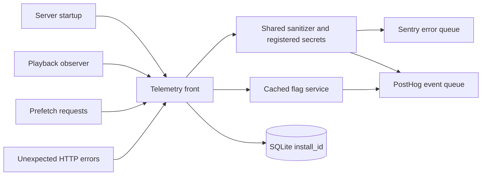

# Telemetry

Active contributors: VeroxAUS

## Purpose

Telemetry is the optional outbound boundary for server error reports, typed product events and remote feature flags. Local logs, SSE and Prometheus metrics remain available without telemetry keys (`apps/server/src/telemetry/index.ts`). The privacy policy is `docs/PRIVACY.md`; the cross-runtime scrubber is documented under [shared](../packages/shared.md).

## Activation and ownership

`createTelemetry` in `apps/server/src/telemetry/index.ts` builds the `Telemetry` interface from `apps/server/src/telemetry/types.ts`. Missing `SENTRY_DSN_SERVER` disables Sentry; missing `POSTHOG_API_KEY` disables product events and remote flag evaluation independently. With neither key, or `HOMESTREAM_TELEMETRY=off`, methods are no-ops and flags resolve to local defaults.

The master switch also accepts `0`, `false`, `no` and `disabled`, case-insensitively (`apps/server/src/config.ts`). Invalid Sentry initialization leaves error reporting off. Analytics startup failure is caught and logged without credentials. Capture/error/breadcrumb calls catch reporting failures rather than throwing into playback or HTTP handlers.

App construction owns the clients unless telemetry was injected; the close hook flushes owned telemetry before closing its database (`apps/server/src/app.ts`). Shutdown is idempotent and gives Sentry and PostHog **2 seconds each**, concurrently. Sentry is an SDK-global client, while the app owns its front's lifetime; do not assume isolated global SDK state across multiple apps in one process.

## Sentry

`apps/server/src/telemetry/sentry.ts` sets release `homestream@<version>`, environment from configuration, and tag `app=server`. Manual error context can add `request_id`, `device.kind`, `media.type` and short tags. `apps/server/src/app.ts` reports unexpected HTTP server errors with the request ID; expected `AppError` responses take their normal error path. The playback observer reports running failures using a constructed code-only error and adds lifecycle breadcrumbs (`apps/server/src/telemetry/playbackObserver.ts`).

The SDK keeps a restricted error-oriented integration list, including uncaught-exception/unhandled-rejection handling. It excludes HTTP/framework/database auto-instrumentation, console capture and session capture. No request bodies, headers, cookies, user or server name are attached; client reports are disabled and breadcrumbs are capped at **50**.

A **5% sampler** is configured for explicitly created transactions/spans, with zero sampling for `/hls/*`, `/metrics`, `/healthz`, `/readyz` and `/api/events`. There are no server `startSpan` call sites or automatic request spans in the current implementation. Accepting `sentry-trace`/`baggage` through CORS does not create an end-to-end trace. See [tracing](../how-to-monitor/tracing.md).

`beforeSend`, `beforeSendTransaction` and `beforeBreadcrumb` invoke `packages/shared/src/sanitize.ts`. It removes URL/token/query/address patterns, denied fields and personal home prefixes; known installation/repository prefixes are cut from stack frames. Context is trimmed to OS/runtime and coarse device facts, retaining only device architecture, processor count and memory size. `apps/server/src/telemetry/scrub.ts` also replaces machine/user names of at least three characters as whole words. This filtering is an explicit boundary, not permission to capture arbitrary user text or paths.

## PostHog catalog and queue

`AnalyticsClient` in `apps/server/src/telemetry/posthog.ts` batches at **20 events** or **10 seconds**, with **5 s** request timeout, **2 s** flag request timeout and one fetch retry. Autocapture, exception autocapture, person profiles, GeoIP, remote config and flag-call events are disabled.

Only these five events are declared in `packages/shared/src/analytics.ts`:

| Event                | Allowed properties                                                                                                                               |
| -------------------- | ------------------------------------------------------------------------------------------------------------------------------------------------ |
| `server_started`     | `version`, `os`, `packaged`, `nodeMajor`                                                                                                         |
| `playback_started`   | `mediaType`, `tmdbId`, `title`, optional `season`/`episode`, `deviceKind`, `videoCodec`, `hdr`, optional `toneMapped`, `resolution`, `startupMs` |
| `playback_ended`     | `mediaType`, `tmdbId`, `title`, `deviceKind`, `reason`, `watchedSec`, optional `avgSpeed`                                                        |
| `playback_failed`    | `mediaType`, `tmdbId`, optional `title`, `deviceKind`, `stage`, `errorCode`                                                                      |
| `prefetch_requested` | `mediaType`, `tmdbId`, `deviceKind`, `flagEnabled`                                                                                               |

The client adds `app=server`, `appVersion` and a random install UUID as `distinctId`. That UUID is created only when analytics initializes and stored at `settings.install_id` (`apps/server/src/db/settings.ts`). It is not a device ID or account.

`sanitizeEventProperties` in `packages/shared/src/analytics.ts` drops unknown events/properties and individually rejects invalid values. Titles are TMDB media names, limited to **200 characters**, and may retain scrubbed text; other strings are omitted if scrubbing changes them. Numeric limits include positive TMDB IDs ≤100,000,000, startup ≤3,600,000 ms, watched time ≤86,400 s and average speed ≤100. Error codes match `[a-z0-9_]{1,48}`. Capture does not send session/device IDs, IPs, filenames, source URLs or typed search text. Product events do contain viewed media identity and titles when enabled; “anonymous” does not mean content-free.

## Flags

`FlagService` in `apps/server/src/telemetry/flags.ts` warms every registry key asynchronously at startup. Cached values are reused for **5 minutes**; stale reads return immediately and refresh in the background. A cold read waits up to **250 ms**, then returns the local default while its shared fetch continues. Remote failure, unknown keys and invalid variants use defaults. This bounded first-read wait is the exception to the otherwise non-awaited capture path.

| Flag                       | Local default         | Actual status                                                                                |
| -------------------------- | --------------------- | -------------------------------------------------------------------------------------------- |
| `prefetch-on-details`      | `true`                | Active server gate in `apps/server/src/prefetch/service.ts`; false skips speculative warming |
| `banner-rotation-interval` | `9s`, alternate `12s` | Planned registry entry, not an implemented banner UI experiment                              |

The import-free registry is `packages/shared/src/flags.ts`. `scripts/flags.mjs` checks unknown/dead evaluations and syncs missing flags using a separate personal API credential. Registry warm-up is not evidence that a planned product behavior exists. See [prefetch](../features/prefetch.md) and [configuration](../reference/configuration.md).

## Modification and validation

Add events to `packages/shared/src/analytics.ts` and `docs/PRIVACY.md` together, then capture through the front rather than an SDK call. Add flags with safe local defaults; preserve bounded evaluation and background refresh. Test against stub collectors and inspect payloads, including unknown/invalid properties and secret needles.

`pnpm telemetry:smoke --sentry` or `--posthog` sends a deliberate report/event when configured (`apps/server/src/telemetry/smoke.ts`). The command prints a run ID and returns success even for missing keys/unreachable services; verify delivery separately. It uses an in-memory database rather than the normal installation identity. It was not run for this documentation.

## Key source files

| File                                                | Purpose                                             |
| --------------------------------------------------- | --------------------------------------------------- |
| `apps/server/src/telemetry/index.ts`                | Front, no-op behavior, client creation and shutdown |
| `apps/server/src/telemetry/types.ts`                | Safe reporting interface and error context          |
| `apps/server/src/telemetry/sentry.ts`               | SDK integrations, sampling and payload hooks        |
| `apps/server/src/telemetry/posthog.ts`              | Typed batching and flag transport                   |
| `apps/server/src/telemetry/flags.ts`                | Cache, deduplication and cold-read budget           |
| `apps/server/src/telemetry/scrub.ts`                | Secret and machine/user scrubbing                   |
| `apps/server/src/telemetry/playbackObserver.ts`     | Lifecycle metrics/events and running failures       |
| `packages/shared/src/analytics.ts`                  | Event allowlist and value validation                |
| `packages/shared/src/sanitize.ts`                   | Shared text/object/Sentry filtering                 |
| `packages/shared/src/flags.ts`                      | Active/planned registry and defaults                |
| `apps/server/test/integration/telemetryApp.test.ts` | HTTP/reporting integration                          |
| `apps/server/test/telemetry/telemetryOff.test.ts`   | Disabled telemetry behavior                         |
| `apps/server/test/telemetry/telemetryOn.test.ts`    | Stub-collector payload verification                 |

## Measured scope

At `bb48e6d`, **9 tracked TypeScript source files** under `apps/server/src/telemetry/`, **6 directly scoped test files** (that test directory plus `apps/server/test/integration/telemetryApp.test.ts`), and **0.67 test-to-code file ratio**. Shared sanitization/catalog/flag tests and cross-cutting metrics tests are excluded. Default-branch ownership/history has **1 unique human author**, VeroxAUS, excluding bots. Counts do not imply external smoke tests were executed.
