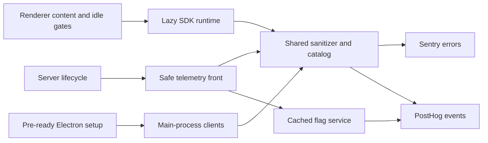

# Telemetry

Active contributors: VeroxAUS

HomeStream optionally reports scrubbed Sentry errors, typed PostHog events and feature flags. Server, browser and Electron main-process wiring are implemented; local logs/SSE/metrics work without cloud telemetry. `docs/PRIVACY.md` is the maintained disclosure. See [security](../security.md).

## Activation and lifecycle

`createTelemetry` in `apps/server/src/telemetry/index.ts` independently enables errors for `SENTRY_DSN_SERVER` and analytics for `POSTHOG_API_KEY`. No matching keys, or the master disable, returns `createNoopTelemetry`: captures do nothing and flags resolve local defaults. Failed client startup stays disabled instead of breaking the server.

| Runtime                  | Configuration and startup                                                                                                                   |
| ------------------------ | ------------------------------------------------------------------------------------------------------------------------------------------- |
| Server                   | Runtime config from `apps/server/src/config.ts`; `HOMESTREAM_TELEMETRY=off` overrides keys                                                  |
| Browser/desktop renderer | Build-time `SENTRY_DSN_WEB`, `POSTHOG_API_KEY`, host/release/environment in `apps/web/src/telemetry/buildEnv.ts`; no runtime key fetch      |
| Electron main            | `startTelemetry` in `apps/desktop/src/shell/telemetry.ts`, called before app readiness by `apps/desktop/src/main.ts`; uses `SENTRY_DSN_WEB` |

Browser `localStorage['homestream.telemetry']='off'` disables its runtime on reload. An already-built UI does not change when server environment variables change.

`telemetryFromEnv` in `apps/web/src/telemetry/buildEnv.ts` replaces the Sentry DSN, PostHog key and PostHog host with `null` in test mode or when the trimmed master setting matches `off`, `0`, `false`, `no` or `disabled` case-insensitively. This strips those values before Vite injects the renderer configuration; a browser-local opt-out instead disables a build that may still contain its configured keys. `apps/web/src/telemetry/buildEnv.test.ts` covers the key-free off-build behavior.

The root `turbo.json` lists every web-build environment read in the build task's `env`, so strict-mode `pnpm build` receives them. `apps/web/turbo.json` disables caching for the web build: Vite also reads `.env`, and restoring a cached output can leave older key-bearing assets alongside the restored files. A fresh Vite build empties `dist` (`apps/web/vite.config.ts`). `apps/web/src/telemetry/turboEnv.test.ts` compares reads against declarations in both directions and guards `cache: false`. See [build and tests](../apps/web/build-and-tests.md).

Server PostHog creates a random installation ID in SQLite settings when constructed (`apps/server/src/db/settings.ts`). Browser uses its anonymous localStorage SDK identity without identify calls. Desktop keeps a random `install-id` in Electron user data; shell startup creates/loads it. None is an account or capability-registration device ID.



Server shutdown is idempotent, flushing clients concurrently with **2-second** budgets. Desktop shell quit flushes its clients with bounded budgets too. See [desktop lifecycle](../apps/desktop/index.md).

## Renderer performance boundary

`startTelemetryWhenIdle` in `apps/web/src/telemetry/index.ts` is SDK-free in the initial bundle. Without a key or with an opt-out it requests neither runtime chunk nor telemetry. With a key, it waits for the `hs:home-content` mark and idle time before importing `apps/web/src/telemetry/runtime.ts`.

`apps/web/src/lib/startup.ts` supplies an eight-second content fallback and a three-second idle timeout. These protect startup from a missing mark; they are not an unconditional guarantee that content always precedes SDK loading. Runtime failures degrade to disabled telemetry.

Page views use route templates from `apps/web/src/telemetry/routes.ts`, never real ID-bearing paths, search strings or resume parameters. `usePageView` in `apps/web/src/telemetry/usePageView.ts` tracks pathname changes. The deliberate query-trigger error is honored only in stub builds. Player/render errors and breadcrumbs still pass the shared scrubber. See [web build and tests](../apps/web/build-and-tests.md).

The navigation search text and browser-local spoiler preference are not catalog events. Settings/About tab selection stays on the same pathname and adds no distinct analytics route (`packages/shared/src/analytics.ts`, `apps/web/src/pages/SettingsPage.tsx`). Do not infer a new event from the presence of a UI control.

## Sentry behavior, not automatic tracing

`initSentry` in `apps/server/src/telemetry/sentry.ts` retains error-oriented integrations, excluding automatic HTTP/framework/database instrumentation, console capture and sessions. The configured **5%** sampler excludes HLS, metrics, probes and SSE, but does not create automatic request traces. Browser and Electron main sampling are **zero**. See [tracing](../how-to-monitor/tracing.md).

Reports carry `homestream@<version>`, environment and bounded tags. Server adds `app=server` and optional request/device/media context. Renderer uses `app=web` in browsers or `app=desktop` in the shell, `process=renderer`, device kind and route template; main uses `app=desktop`, `process=main`, `device.kind=desktop` (`apps/web/src/telemetry/sentry.ts`, `apps/desktop/src/telemetry/sentry.ts`). Both main and renderer use the web Sentry project. Breadcrumbs cap at 50.

### Desktop main-process breadcrumbs

`startTelemetry` in `apps/desktop/src/shell/telemetry.ts` connects the logger callback to `Sentry.addBreadcrumb(mainBreadcrumb(level, message))` only after Sentry initializes successfully. `apps/desktop/src/logger.ts` sends **info, warn and error**, not debug. The callback receives the scrubbed message only, not the structured log fields. `mainBreadcrumb` in `apps/desktop/src/telemetry/sentry.ts` sets category **`main`** and maps logger `warn` to Sentry **`warning`**, retaining info/error levels. This distinguishes main-process context from renderer breadcrumbs without creating a new analytics event or a trace.

The file sink still writes `desktop.log` when cloud telemetry is off. With no DSN, master opt-out or failed initialization there is no Sentry breadcrumb callback. Messages pass `createMainScrubber().text` before the callback, and Sentry's `beforeBreadcrumb` applies the shared breadcrumb sanitizer plus machine/user-name scrubbing again (`apps/desktop/src/telemetry/scrub.ts`). The 50-breadcrumb cap and zero main-process trace sampling remain unchanged. See [logging](../how-to-monitor/logging.md) and [desktop lifecycle](../apps/desktop/index.md).

`sanitizeSentryEvent` in `packages/shared/src/sanitize.ts` removes request/server/user/auth/address data, scrubs nested strings, makes configured stack roots relative, drops culture context and trims device context to coarse hardware facts. Server-specific registered-secret/machine scrubbing feeds it through `apps/server/src/telemetry/scrub.ts`.

After stripping incoming user data, the sanitizer deliberately sets:

```json
{
  "sdk": { "settings": { "infer_ip": "never" } },
  "user": { "geo": {} }
}
```

The empty geo prevents ingestion-side fallback location lookup; do not remove it as redundant or describe it as identity. These client controls do not replace account settings: enable Sentry **Prevent Storing of IP Addresses** and PostHog **Discard client IP data**, and inspect stored payloads. This wiki did not verify account state, ingestion behavior or delivery.

## Analytics catalog and privacy exception

`ANALYTICS_EVENTS` and `sanitizeEventProperties` in `packages/shared/src/analytics.ts` define seven permitted event names. Unknown events are dropped; unknown/invalid properties are omitted individually.

| Event                | Allowed information                                                                                                  |
| -------------------- | -------------------------------------------------------------------------------------------------------------------- |
| `server_started`     | Version, OS enum, packaged status, Node major                                                                        |
| `playback_started`   | Media type/TMDB ID/title, optional episode identity, device kind, codec/HDR/tone-map/resolution and startup duration |
| `playback_ended`     | Media identity/title, device kind, end reason, watched time and optional speed                                       |
| `playback_failed`    | Media identity, optional title, device kind, stage and short error code                                              |
| `page_viewed`        | Route template and device kind                                                                                       |
| `desktop_started`    | Version, OS enum, packaged/hidden status                                                                             |
| `prefetch_requested` | Media type/TMDB ID, device kind and flag outcome                                                                     |

**A TMDB media title is the only permitted free-text property**, bounded to 200 characters and scrubbed. It is not user-entered text. Unlike other strings changed by sanitization, titles retain their cleaned value. Media IDs/titles still reveal viewing-related information; “anonymous” does not mean content-free. Do not send search text, names, paths, addresses, URLs or keys.

`AnalyticsClient` in `apps/server/src/telemetry/posthog.ts` batches at **20 events or 10 seconds**, with **5-second requests**, **2-second flag requests** and one fetch retry. It disables GeoIP, remote config, exception autocapture and flag-evaluation events. Playback observers emit lifecycle summaries rather than per-segment events.

Browser `apps/web/src/telemetry/posthog.ts` uses the slim SDK and flags extension; `restrictToCatalog` rebuilds allowed properties and strips automatic URL/referrer/person payloads. Autocapture, replay, automatic pageviews, surveys and external dependency loading are disabled. Desktop `DesktopAnalytics` in `apps/desktop/src/telemetry/analytics.ts` batches at **10 events or 10 seconds**, with five-second requests and one retry. All fronts use shared allowlists and no-person-profile/GeoIP controls.

## Feature flags

`FlagService` in `apps/server/src/telemetry/flags.ts` returns stale cached values immediately after **five minutes**, deduplicates refreshes and bounds a first cold read to **250 ms**. The server prewarms registry keys asynchronously. Missing/failed analytics resolves defaults rather than blocking indefinitely.

| Registry key               | Default and consumer                                                 |
| -------------------------- | -------------------------------------------------------------------- |
| `prefetch-on-details`      | `true`, server warm-up gate in `apps/server/src/prefetch/service.ts` |
| `banner-rotation-interval` | `9s`, alternate `12s`; renderer lazy runtime updates banner interval |

`packages/shared/src/flags.ts` owns defaults/coercion. Renderer `watchFlag` suppresses evaluation events. Actual detail/player prefetch wiring belongs to [prefetch](../features/prefetch.md), not an inference from the flag's existence.

## Modify and verify

Follow `.factory/skills/homestream-telemetry/SKILL.md`: update the typed catalog and `docs/PRIVACY.md` together, preserve opt-outs/allowlists, and test malicious payloads and no-key behavior. Keep SDK work off Home/playback paths. Local profiling and cloud smoke commands are distinct activities; neither was run for this refresh.

Server stub tests, shared sanitizer tests, renderer unit/e2e collectors and desktop wiring tests cover different boundaries. `apps/desktop/test/integration/telemetryWiring.test.ts` checks main-category level mapping, options/tags, no-key/opt-out behavior and scrubbed breadcrumbs; `apps/desktop/test/logger.test.ts` checks the info-and-above threshold and scrubbed messages. These test helpers/options rather than launching the actual Electron SDK adapter. Main shell initialization is real code, not merely an option builder, but source inspection does not prove a live cloud event arrived.

## Key source files

| File                                                    | Purpose                                                   |
| ------------------------------------------------------- | --------------------------------------------------------- |
| `apps/server/src/telemetry/index.ts`                    | Safe front/no-op, flags and shutdown                      |
| `apps/server/src/telemetry/sentry.ts`                   | Restricted error integrations and sampler                 |
| `apps/server/src/telemetry/posthog.ts`                  | Queue and flag transport                                  |
| `apps/server/src/telemetry/playbackObserver.ts`         | Lifecycle metrics/events/breadcrumb bridge                |
| `apps/web/src/telemetry/index.ts`                       | Initial SDK-free gate                                     |
| `apps/web/src/telemetry/buildEnv.ts`                    | Build-time config and stripping keys in test/off builds   |
| `apps/web/src/telemetry/turboEnv.test.ts`               | Build env declarations and web no-cache regression        |
| `apps/web/turbo.json`                                   | Web build cache override                                  |
| `apps/web/src/telemetry/runtime.ts`                     | Deferred clients and route/flag wiring                    |
| `apps/desktop/src/shell/telemetry.ts`                   | Executed main setup, log sink, identity and flush         |
| `apps/desktop/src/telemetry/sentry.ts`                  | Main options, tags and breadcrumb mapping                 |
| `apps/desktop/src/logger.ts`                            | Scrubbed messages and info-and-above breadcrumb threshold |
| `apps/desktop/test/integration/telemetryWiring.test.ts` | Offline main options, breadcrumb and privacy regressions  |
| `packages/shared/src/analytics.ts`                      | Typed event/property catalog                              |
| `packages/shared/src/sanitize.ts`                       | Shared scrubber and inference controls                    |

## Measured scope

At `663492c`, **9 production `.ts` files** under `apps/server/src/telemetry/` and **5 `.test.ts` files** under `apps/server/test/telemetry/` yield a **0.56 test/source file ratio**. Counts use committed paths from `git ls-tree -r --name-only HEAD`. Stub helpers, integration tests, flag registry outside the folder, browser/desktop/shared source and tests are excluded. Scoped `origin/main` history for those server telemetry folders has **1 unique human author** after excluding bots, VeroxAUS, matching `.github/CODEOWNERS`. These are inventory counts, not coverage.
